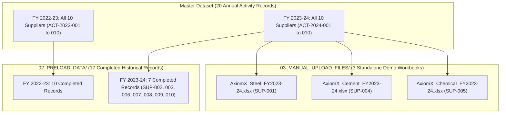

# Scope3Track — Synthetic Demonstration Dataset Generation Report

**Document Date**: November 8, 2026  
**Package Scope**: `PUBLIC_DATASET_RESEARCH/07_SYNTHETIC_DEMO_DATASET/`  
**Classification**: SYNTHETIC DEMONSTRATION DATA — NOT ACTUAL COMPANY DISCLOSURES  
**Mandatory Reporting Years**: **FY 2022-23 (Baseline)** and **FY 2023-24 (Reporting Year)**  

---

## 1. Project Background and Objective
The Scope3Track platform requires a realistic, auditable, and mathematically coherent synthetic supplier dataset to support the upcoming hackathon demonstration. The dataset enables demonstrating supplier activity ingestion, automated Scope 1 and Scope 2 calculation, product carbon footprint receipt generation, and manufacturer Scope 3 aggregation (Category 1 Purchased Goods and Category 2 Capital Goods).

### Strict Boundary Enforcement
- **Phase 1 Only**: This task generates, organizes, and validates all file artifacts.
- **Zero Prototype Intrusion**: No files in `backend/`, `frontend/`, or MongoDB collections were modified.
- **Standby State**: The three manual demonstration workbooks remain untouched in `03_MANUAL_UPLOAD_FILES/` ready for live demonstration.

---

## 2. Supplier Master Architecture (10 Fictional Entities)

| Supplier ID | Supplier Name | Sector | Representative Product | SKU Code | Scope 3 Category | Base Price (INR) | Plant Location |
| :--- | :--- | :--- | :--- | :--- | :--- | :--- | :--- |
| **SUP-001** | AxiomX Steel Suppliers | Steel | Hot-rolled steel coils | `ST-HR-001` | Category 1 | INR 55,000 / t | Vijayanagar, Karnataka |
| **SUP-002** | AxiomX Rubber Suppliers | Rubber | Industrial rubber sheets | `RB-TY-002` | Category 1 | INR 1,85,000 / t | Limda, Gujarat |
| **SUP-003** | AxiomX Aluminium Suppliers | Aluminium | Aluminium ingots | `AL-IN-003` | Category 1 | INR 2,30,000 / t | Renukoot, Uttar Pradesh |
| **SUP-004** | AxiomX Cement Suppliers | Cement | PPC cement | `CM-PC-004` | Category 1 | INR 7,300 / t | Kotputli, Rajasthan |
| **SUP-005** | AxiomX Chemical Suppliers | Chemicals | Soda ash | `CH-SA-005` | Category 1 | INR 28,500 / t | Mithapur, Gujarat |
| **SUP-006** | AxiomX Packaging Suppliers | Packaging | Corrugated packaging | `PK-BX-006` | Category 1 | INR 73,000 / t | Songadh, Gujarat |
| **SUP-007** | AxiomX Textile Suppliers | Textiles | Industrial fabric | `TX-FC-007` | Category 1 | INR 2,85,000 / t | Santej, Gujarat |
| **SUP-008** | AxiomX Glass Suppliers | Glass | Industrial glass sheets | `GL-SG-008` | Category 1 | INR 66,000 / t | Bawal, Haryana |
| **SUP-009** | AxiomX Polymer Suppliers | Polymers | HDPE pipes | `PL-PP-009` | Category 1 | INR 1,27,000 / t | Jalgaon, Maharashtra |
| **SUP-010** | AxiomX Machinery Suppliers | Machinery | Industrial boilers | `MC-SG-010` | **Category 2** | INR 1,50,00,000 / unit | Haridwar, Uttarakhand |

---

## 3. Dataset Distribution & Historical Partitioning

---

## 4. Calculated Emissions & YoY Trajectories

All calculations apply statutory emission factors:
- **Grid Electricity (Scope 2)**:
  - FY 2022-23: **0.716 kg CO2e / kWh** (CEA v19.0)
  - FY 2023-24: **0.727 kg CO2e / kWh** (CEA v20.0)
- **High Speed Diesel (Scope 1)**:
  - All years: **2.68 kg CO2e / Litre** (IPCC 2006 Vol 2 Ch 2 Table 2.2)

### Summary of Synthetic Calculated Emissions
| Supplier ID | Supplier Name | FY23 Output (t) | FY23 Intensity (kg/t) | FY24 Output (t) | FY24 Intensity (kg/t) | YoY Intensity Trend | Primary Operational Cause |
| :--- | :--- | :--- | :--- | :--- | :--- | :--- | :--- |
| **SUP-001** | AxiomX Steel | 160,000 | 319.73 | 175,000 | 334.16 | **+4.51%** | New rolling line ramp-up |
| **SUP-002** | AxiomX Rubber | 12,500 | 675.49 | 13,200 | 651.87 | **-3.50%** | Variable frequency drive retrofits |
| **SUP-003** | AxiomX Aluminium | 26,000 | 1,396.37 | 27,500 | 1,441.03 | **+3.20%** | High-spec aerospace alloy mix |
| **SUP-004** | AxiomX Cement | 420,000 | 58.91 | 455,000 | 59.90 | **+1.68%** | Stable grinding plant footprint |
| **SUP-005** | AxiomX Chemical | 55,000 | 294.44 | 53,500 | 309.09 | **+4.98%** | Kiln overhaul turnaround |
| **SUP-006** | AxiomX Packaging | 32,000 | 338.57 | 34,500 | 325.67 | **-3.81%** | Steam condensate heat recovery |
| **SUP-007** | AxiomX Textile | 16,000 | 993.40 | 17,000 | 964.19 | **-2.94%** | Servo looper motor upgrades |
| **SUP-008** | AxiomX Glass | 44,000 | 483.83 | 46,500 | 496.09 | **+2.53%** | Batch preheater line addition |
| **SUP-009** | AxiomX Polymer | 22,000 | 455.49 | 24,000 | 465.04 | **+2.09%** | New pipe extrusion line online |
| **SUP-010** | AxiomX Machinery | 9,000 (54 units) | 792.00 | 9,800 (59 units) | 772.56 | **-2.46%** | Automated submerged arc welding |

---

## 5. Manufacturer Purchase Dataset (ABC Manufacturing Ltd)
- **Total Purchases**: 20 transactions across 10 suppliers.
- **FY 2022-23**: 10 transactions totaling **INR 24,86,65,000** (INR 24.87 Crores).
  - 9 Category 1 transactions (operational raw materials): INR 21.87 Crores.
  - 1 Category 2 transaction (2 industrial boilers from SUP-010): INR 3.00 Crores.
- **FY 2023-24**: 10 transactions totaling **INR 28,68,75,000** (INR 28.69 Crores).
  - 9 Category 1 transactions: INR 24.04 Crores.
  - 1 Category 2 transaction (3 industrial boilers from SUP-010): INR 4.65 Crores.
- **Clean Segregation**: Capital goods (industrial boilers) are distinctly classified as **Scope 3 Category 2: Capital Goods**, enabling separate dashboard aggregation without double-counting.

---

## 6. Phase 2 Readiness Notice
The generated artifacts in `07_SYNTHETIC_DEMO_DATASET/` are 100% complete, verified, and sealed.
**Phase 1 concludes here. Prototype integration will begin only after explicit user approval.**