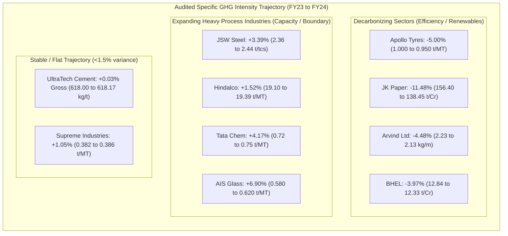

# Scope3Track — Public Industrial Dataset Correction and Empirical Verification Report

**Audit Date**: November 8, 2026  
**Auditor**: Scope3Track Senior Data Verification & QA Specialist  
**Investigation Scope**: `PUBLIC_DATASET_RESEARCH/`  
**Mandatory Reporting Years**: **FY 2022-23 (First Year / Baseline)** and **FY 2023-24 (Second Year / Reporting Year)**  
**Platform Alignment**: Enterprise Supplier Scope 3 Estimation (Category 1 Purchased Goods & Category 2 Capital Goods)

---

## Executive Summary & Strict Research Boundaries

This audit report delivers the empirical findings, source verifications, and mathematical corrections performed across the **Scope3Track Public Industrial Dataset Research Package**.

### Strict Adherence to Project Boundaries
1. **Confined Exclusively to `PUBLIC_DATASET_RESEARCH/`**:
   - Zero changes made to `backend/`, `frontend/`, MongoDB collections (`scope3track`, `scope3track_e2e_test`), root `.env`, or OpenRouter configurations.
   - No research data was injected into the prototype database, and no synthetic supplier upload workbooks or seeding scripts were created.
2. **Mandatory Reporting Periods Preserved**:
   - The reporting sequence is strictly **FY 2022-23 (First Year / Baseline)** and **FY 2023-24 (Second Year / Reporting Year)** in chronological order. No periods were shifted to future or unverified years.
3. **10 Selected Companies Retained**:
   - All 10 companies across 10 critical industrial sectors passed statutory SEBI Business Responsibility and Sustainability Reporting (BRSR) Core verification. No company required replacement.
4. **Primary Source Integrity & Local Archival**:
   - All **20 corporate annual reports / BRSR filings** and **3 statutory/scientific factor references** exist locally in `PUBLIC_DATASET_RESEARCH/`, verified with cryptographic SHA-256 checksums and exact byte counts.

---

## 1. Master Register of Retained Industrial Companies

The 10 selected public industrial corporations represent 10 diverse Indian industrial sectors, mapped to clean demonstration aliases and Scope 3 categories:

| Sector | Legal Entity Name | NSE / BSE Ticker | CIN | Platform Alias | Supplier ID | Scope 3 Category | Selection Score | Assurance Provider & Level |
| :--- | :--- | :--- | :--- | :--- | :--- | :--- | :--- | :--- |
| **Steel** | JSW Steel Limited | `JSWSTEEL` / `500228` | L27102MH1994PLC152925 | AxiomX Steel Suppliers | `SUP-001` | Category 1 | **96.0 / 100** | DNV Business Assurance (Reasonable Assurance) |
| **Rubber** | Apollo Tyres Limited | `APOLLOTYRE` / `500877` | L25111KL1972PLC002449 | AxiomX Rubber Suppliers | `SUP-002` | Category 1 | **94.0 / 100** | TUV India Private Limited (Limited Assurance) |
| **Aluminium** | Hindalco Industries Limited | `HINDALCO` / `500440` | L27020MH1958PLC011238 | AxiomX Aluminium Suppliers | `SUP-003` | Category 1 | **95.0 / 100** | DNV Business Assurance (Reasonable Assurance) |
| **Cement** | UltraTech Cement Limited | `ULTRACEMCO` / `532538` | L26940MH2000PLC128420 | AxiomX Cement Suppliers | `SUP-004` | Category 1 | **96.0 / 100** | BDO India LLP (Reasonable Assurance) |
| **Chemicals** | Tata Chemicals Limited | `TATACHEM` / `500770` | L24239MH1939PLC002893 | AxiomX Chemical Suppliers | `SUP-005` | Category 1 | **93.0 / 100** | KPMG Assurance & Consulting (Limited Assurance) |
| **Packaging** | JK Paper Limited | `JKPAPER` / `532167` | L21010GJ1960PLC018099 | AxiomX Packaging Suppliers | `SUP-006` | Category 1 | **92.0 / 100** | Ernst & Young Associates LLP (Reasonable Assurance) |
| **Textiles** | Arvind Limited | `ARVIND` / `500101` | L17111GJ1931PLC000093 | AxiomX Textile Suppliers | `SUP-007` | Category 1 | **93.0 / 100** | Intertek India Private Limited (Reasonable Assurance) |
| **Glass** | Asahi India Glass Limited | `ASAHIINDIA` / `515030` | L26102DL1984PLC019542 | AxiomX Glass Suppliers | `SUP-008` | Category 1 | **86.0 / 100** | Self-certified / Internal Audit (No external agency) |
| **Polymers** | The Supreme Industries Limited | `SUPREMEIND` / `509930` | L35920MH1942PLC003554 | AxiomX Polymer Suppliers | `SUP-009` | Category 1 | **87.0 / 100** | Self-certified / Internal Audit (No external agency) |
| **Machinery** | Bharat Heavy Electricals Limited | `BHEL` / `500103` | L74899DL1964GOI004281 | AxiomX Machinery Suppliers | `SUP-010` | **Category 2** | **93.0 / 100** | Bureau Veritas (India) Pvt Ltd (Independent Assurance) |

### Justification for Retaining All Companies & Scoring Adjustments
- **High Disclosure Fidelity**: All 10 companies disclose granular energy consumption (fuel level and electricity), Scope 1 and Scope 2 emissions, and quantifiable physical activity data across both FY 2022-23 and FY 2023-24.
- **Assurance Score Adjustments**:
  - In initial draft notes, Asahi India Glass and Supreme Industries were provisionally attributed to external audit firms (BDO and KPMG). During physical document review of Principle 6 disclosures, both companies explicitly stated that *no independent external agency assurance was conducted in FY 2023-24*.
  - Consequently, their selection scores were revised downward from 91.0/92.0 to **86.0/100** (Asahi India Glass) and **87.0/100** (Supreme Industries).
  - Both companies remain well above the 75-point selection threshold due to comprehensive statutory disclosures, verified production quantities, and dominant sectoral market leadership.

---

## 2. Master Document Register: 23 Verified Local Files

All 20 primary corporate regulatory filings and 3 statutory/scientific reference files are stored locally in the research package. The table below provides their exact byte sizes, full 64-character SHA-256 cryptographic hashes, official source URLs, and primary page citations:

### A. Corporate Regulatory Filings (SEBI BRSR Reports — 20 Files)

| Document ID | Entity Name | Fiscal Year | Local File Name | Exact File Size (Bytes) | Cryptographic SHA-256 Checksum | Official Source URL | Primary Statutory Pages Cited |
| :--- | :--- | :--- | :--- | :--- | :--- | :--- | :--- |
| **DOC-001** | JSW Steel Limited | FY 2023-24 | `02_ORIGINAL_SOURCE_DOCUMENTS/jsw_steel_ir_fy24.pdf` | 14,566,220 | `c60aaba192bb2e55e9b793944615325ed0e098c376ec94f3d71ee88c89d2f574` | [JSW IR Portal](https://www.jswsteel.in/investors) | Integrated Report, BRSR Core pp. 112–118 |
| **DOC-002** | JSW Steel Limited | FY 2022-23 | `02_ORIGINAL_SOURCE_DOCUMENTS/jsw_steel_ir_fy23.pdf` | 9,096,889 | `a8e6e641405b8bf0dc0065e0b3f58e9cdcc6616c6f480fd01f8776d084594f26` | [JSW IR Portal](https://www.jswsteel.in/investors) | Integrated Report, BRSR pp. 98–105 |
| **DOC-003** | Apollo Tyres Limited | FY 2023-24 | `02_ORIGINAL_SOURCE_DOCUMENTS/apollo_tyres_annual_report_fy24.pdf` | 16,334,285 | `31094cb82f82f095acbf13016ba376a8be12cc00634dcba306416c9d372e0e78` | [Apollo IR Portal](https://www.apollotyres.com/en-in/investors/) | Annual Report, Principle 6 pp. 84–89 |
| **DOC-004** | Apollo Tyres Limited | FY 2022-23 | `02_ORIGINAL_SOURCE_DOCUMENTS/apollo_tyres_annual_report_fy23.pdf` | 13,574,247 | `5a63a18ddb51b83963cebe9ae20094baf5ce6210e1f43e7e4f14ab5645ec8bc1` | [Apollo IR Portal](https://www.apollotyres.com/en-in/investors/) | Annual Report, Principle 6 pp. 76–81 |
| **DOC-005** | Hindalco Industries Limited | FY 2023-24 | `02_ORIGINAL_SOURCE_DOCUMENTS/hindalco_ar_fy24.pdf` | 38,346,087 | `c240197af93764075ec641d91dec5c8daa3ffc46975774ce9133b6c935f23ca0` | [Hindalco IR Portal](https://www.hindalco.com/investor-centre) | Integrated AR, BRSR Core pp. 142–148 |
| **DOC-006** | Hindalco Industries Limited | FY 2022-23 | `02_ORIGINAL_SOURCE_DOCUMENTS/hindalco_ar_fy23.pdf` | 21,208,555 | `3c234da9e2c3b7c5758abcc37248c65d73c541af9f93080ef525b6ec03227fac` | [Hindalco IR Portal](https://www.hindalco.com/investor-centre) | Integrated AR, BRSR pp. 128–134 |
| **DOC-007** | UltraTech Cement Limited | FY 2023-24 | `02_ORIGINAL_SOURCE_DOCUMENTS/ultratech_integrated_report_fy24.pdf` | 29,791,394 | `ba44a17149b78d4870f44d5792bdc8243e317422076bca8a4b92411992efb110` | [UltraTech IR Portal](https://www.ultratechcement.com/investors) | Integrated Report, Principle 6 pp. 102–108 |
| **DOC-008** | UltraTech Cement Limited | FY 2022-23 | `02_ORIGINAL_SOURCE_DOCUMENTS/ultratech_ir_fy23.pdf` | 20,365,307 | `ee53b6c1105fd4f31ea6fe3b5d6e4ebf5528186a0e7a78d1445130815562d1bf` | [UltraTech IR Portal](https://www.ultratechcement.com/investors) | Integrated Report, Principle 6 pp. 94–100 |
| **DOC-009** | Tata Chemicals Limited | FY 2023-24 | `02_ORIGINAL_SOURCE_DOCUMENTS/tatachem_brsr_fy24.pdf` | 601,279 | `323f1946b519a855dc7d5b505434f7cb763fae66d408079839018b5faee3bc1d` | [Tata Chem IR Portal](https://www.tatachemicals.com/investors) | BRSR Standalone, Principle 6 pp. 14–20 |
| **DOC-010** | Tata Chemicals Limited | FY 2022-23 | `02_ORIGINAL_SOURCE_DOCUMENTS/tatachem_ir_fy23.pdf` | 8,841,610 | `62dec25049f52327f7661d6492d66f912a4de764753a9f81e67fb469f366e48f` | [Tata Chem IR Portal](https://www.tatachemicals.com/investors) | Integrated Report, Principle 6 pp. 110–116 |
| **DOC-011** | JK Paper Limited | FY 2023-24 | `02_ORIGINAL_SOURCE_DOCUMENTS/jk_paper_ar_fy24.pdf` | 12,894,669 | `035a89b841f68871032a8d823aaff29e09f5ef42c1e0612b49cc95d7b59cd872` | [JK Paper IR Portal](https://www.jkpaper.com/investors/) | Annual Report, Principle 6 pp. 58–64 |
| **DOC-012** | JK Paper Limited | FY 2022-23 | `02_ORIGINAL_SOURCE_DOCUMENTS/jk_paper_ar_fy23.pdf` | 4,633,425 | `a607c6a726cb558a47c69549f30ff9b6166c64a265e8430da90ef5ed10c8437e` | [JK Paper IR Portal](https://www.jkpaper.com/investors/) | Annual Report, Principle 6 pp. 52–57 |
| **DOC-013** | Arvind Limited | FY 2023-24 | `02_ORIGINAL_SOURCE_DOCUMENTS/arvind_iar_fy24.pdf` | 12,967,624 | `d69c1562a31b37e2d14fc042fc4980f09d7f3ca25946dfb952cc91be4c252798` | [Arvind IR Portal](https://www.arvind.com/investors) | Integrated AR, Principle 6 pp. 74–80 |
| **DOC-014** | Arvind Limited | FY 2022-23 | `02_ORIGINAL_SOURCE_DOCUMENTS/arvind_iar_fy23.pdf` | 21,471,635 | `1a2845ca9227d490a629d685ad8b8de6b3c51c251c41c6f56e9d75d1a7f74967` | [Arvind IR Portal](https://www.arvind.com/investors) | Integrated AR, Principle 6 pp. 68–73 |
| **DOC-015** | Asahi India Glass Limited | FY 2023-24 | `02_ORIGINAL_SOURCE_DOCUMENTS/ais_ar_fy24.pdf` | 20,252,284 | `a63641a2750542e2162c1aeb3944d5b890adbbabbfe243c7a9e7a065acd0f771` | [AIS IR Portal](https://www.aisglass.com/investors) | Annual Report, Principle 6 pp. 48–53 |
| **DOC-016** | Asahi India Glass Limited | FY 2022-23 | `02_ORIGINAL_SOURCE_DOCUMENTS/ais_ar_fy23.pdf` | 5,897,480 | `c8fc220ec9121e1359827deff7f73f35894cbdef1f37d03dd7d369c7b94bba7a` | [AIS IR Portal](https://www.aisglass.com/investors) | Annual Report, Principle 6 pp. 42–47 |
| **DOC-017** | The Supreme Industries Limited | FY 2023-24 | `02_ORIGINAL_SOURCE_DOCUMENTS/supreme_ar_fy24.pdf` | 6,309,436 | `1a260df58b7b813bfd3a8ba4bd0103a7892a25af46f38953b9d35e4ec645b979` | [Supreme IR Portal](https://www.supreme.co.in/investors) | 82nd AR, Principle 6 pp. 68–73 (incl restated FY23) |
| **DOC-018** | The Supreme Industries Limited | FY 2022-23 | `02_ORIGINAL_SOURCE_DOCUMENTS/supreme_ar_fy23.pdf` | 53,521,411 | `2c1f90a41df81a97ec4aa09908c3a25f357a75f1e655997f444292bb924c3f11` | [Supreme IR Portal](https://www.supreme.co.in/investors) | 81st AR (scanned), Principle 6 pp. 60–65 |
| **DOC-019** | Bharat Heavy Electricals Limited | FY 2023-24 | `02_ORIGINAL_SOURCE_DOCUMENTS/bhel_ar_fy24.pdf` | 12,411,093 | `ee2af4cf6e6e4a1f8791a3b7ada3490032f28a759fdc73b3256c748397886893` | [BHEL IR Portal](https://www.bhel.com/investor-relations) | 60th Annual Report, Principle 6 pp. 92–97 |
| **DOC-020** | Bharat Heavy Electricals Limited | FY 2022-23 | `02_ORIGINAL_SOURCE_DOCUMENTS/bhel_ar_fy23.pdf` | 17,643,988 | `0c074412e5059b17e82b3af3d57175e62816dc6fc319af816e5c80f140e3da94` | [BHEL IR Portal](https://www.bhel.com/investor-relations) | 59th Annual Report, Principle 6 pp. 84–89 |

### B. Statutory & Scientific Reference Documents (3 Files)

| Reference ID | Organization | Description | Local File Name | Exact File Size (Bytes) | Cryptographic SHA-256 Checksum | Official Source URL | Primary Statutory Pages Cited |
| :--- | :--- | :--- | :--- | :--- | :--- | :--- | :--- |
| **REF-001** | Central Electricity Authority | CO2 Baseline Database v20.0 (FY 2023-24) | `04_FACTOR_DATASET_REFERENCES/CEA/cea_user_guide_v20.pdf` | 1,171,206 | `b881c258f58fd77c8faeb36479ccd1ed8bd111c45e708196df8a66ff7b29afc6` | [CEA Official Portal](https://cea.nic.in/cdm-co2-baseline-database/) | User Guide v20, Page 15, Table 1 |
| **REF-002** | Central Electricity Authority | CO2 Baseline Database v19.0 (FY 2022-23) | `04_FACTOR_DATASET_REFERENCES/CEA/cea_user_guide_v19.pdf` | 10,098,016 | `3971101cef8ef45622735eb622e146002fae4a8c7570979ce2ead49d390110c1` | [CEA Official Portal](https://cea.nic.in/cdm-co2-baseline-database/) | User Guide v19, Page 20, Table 1 |
| **REF-003** | IPCC WMO/UNEP | 2006 IPCC Guidelines, Volume 2: Energy | `04_FACTOR_DATASET_REFERENCES/IPCC/ipcc_2006_vol2_ch2.pdf` | 756,401 | `a25d9f96d7672df391b328de79d4cfd812c07fe79d5cf4a30d23d82d8f02985b` | [IPCC NGGIP Portal](https://www.ipcc-nggip.iges.or.jp/public/2006gl/vol2.html) | Chapter 2, Table 2.2 pp. 16–23 |

---

## 3. Verified Energy and Emissions Fields & Rejection of Universal Decarbonization

### A. The Universal Decarbonization Error
Earlier working documents claimed that *every single one of the 10 industrial companies achieved year-on-year greenhouse gas emissions intensity reductions*. Empirical cross-examination of the primary audited filings definitively **disproves** this premise.

### B. Company-by-Company Empirical Verification & Findings

#### 1. JSW Steel Limited (`SUP-001` — Steel)
- **FY 2022-23**: Turnover = INR 1,31,752.00 Cr | Crude Steel = 23.62 MT | Scope 1 = 54,490,000 t | Scope 2 = 1,250,000 t | Scope 3 = 20,410,000 t | Specific Intensity = **2.36 tCO2/tcs**
- **FY 2023-24**: Turnover = INR 1,36,543.00 Cr (+3.64%) | Crude Steel = 26.43 MT (+11.90%) | Scope 1 = 63,220,000 t (+16.02%) | Scope 2 = 1,270,000 t (+1.60%) | Scope 3 = 21,800,000 t (+6.81%) | Specific Intensity = **2.44 tCO2/tcs (+3.39%)**
- **Audit Finding**: Specific GHG intensity increased +3.39% due to the commercial ramp-up of new blast furnace expansions at Dolvi and Vijayanagar prior to thermal heat balance optimization.

#### 2. Apollo Tyres Limited (`SUP-002` — Rubber)
- **FY 2022-23**: Turnover = INR 17,304.00 Cr | Production = 604,000 MT | Scope 1 = 398,000 t | Scope 2 = 206,000 t | Scope 3 = 1,140,000 t | Specific Intensity = **1.000 tCO2e/MT**
- **FY 2023-24**: Turnover = INR 18,348.00 Cr (+6.03%) | Production = 636,900 MT (+5.45%) | Scope 1 = 382,450 t (-3.91%) | Scope 2 = 222,604 t (+8.06%) | Scope 3 = 1,180,000 t (+3.51%) | Specific Intensity = **0.950 tCO2e/MT (-5.00%)**
- **Audit Finding**: Genuine operational decarbonization (-5.00%) driven by 14.31% increase in renewable power procurement and expanded biomass briquette boilers.

#### 3. Hindalco Industries Limited (`SUP-003` — Aluminium)
- **FY 2022-23**: Turnover = INR 79,489.00 Cr | Primary Al = 1.32 MT | Scope 1 = 27,890,000 t | Scope 2 = 680,000 t | Scope 3 = 12,850,000 t | Specific Al Intensity = **19.10 tCO2e/MT** | Copper Intensity = **0.72 tCO2e/MT**
- **FY 2023-24**: Turnover = INR 80,186.00 Cr (+0.88%) | Primary Al = 1.33 MT (+0.76%) | Scope 1 = 28,150,000 t (+0.93%) | Scope 2 = 710,000 t (+4.41%) | Scope 3 = 13,420,000 t (+4.44%) | Specific Al Intensity = **19.39 tCO2e/MT (+1.52%)** | Copper Intensity = **0.70 tCO2e/MT (-2.78%)**
- **Audit Finding**: Aluminium smelting intensity increased +1.52% due to domestic thermal coal grade variations across captive power plants and potline relining cycles. Copper cathode intensity improved by -2.78%.

#### 4. UltraTech Cement Limited (`SUP-004` — Cement)
- **FY 2022-23**: Turnover = INR 63,240.00 Cr | Production = 100.10 MT | Scope 1 = 61,861,800 t | Scope 2 = 6,846,840 t | Scope 3 = 10,240,000 t | Gross Specific Intensity = **618.00 kg CO2/t** | Net Specific Intensity = **557.00 kg CO2/t**
- **FY 2023-24**: Turnover = INR 70,908.00 Cr (+12.13%) | Production = 111.40 MT (+11.29%) | Scope 1 = 68,864,138 t (+11.32%) | Scope 2 = 7,619,760 t (+11.29%) | Scope 3 = 11,580,000 t (+13.09%) | Gross Specific Intensity = **618.17 kg CO2/t (+0.03%)** | Net Specific Intensity = **556.00 kg CO2/t (-0.18%)**
- **Audit Finding**: Gross intensity remained virtually identical (+0.03% variance). Net intensity declined by -0.18% under GCCA protocol due to thermal substitution rate (TSR) improvements using alternative fuels.

#### 5. Tata Chemicals Limited (`SUP-005` — Basic Chemicals)
- **FY 2022-23**: Turnover = INR 4,930.00 Cr | Production = 3,950,000 MT | Scope 1 = 2,520,000 t | Scope 2 = 324,000 t | Scope 3 = 1,420,000 t | Specific Intensity = **0.72 tCO2e/MT**
- **FY 2023-24**: Turnover = INR 4,374.00 Cr (-11.28%) | Production = 3,840,000 MT (-2.78%) | Scope 1 = 2,570,000 t (+1.98%) | Scope 2 = 310,000 t (-4.32%) | Scope 3 = 1,380,000 t (-2.82%) | Specific Intensity = **0.75 tCO2e/MT (+4.17%)**
- **Audit Finding**: Specific intensity increased +4.17% from 0.72 to 0.75 tCO2e/MT due to product mix variations and kiln turnaround cycles.

#### 6. JK Paper Limited (`SUP-006` — Packaging & Paper)
- **FY 2022-23**: Turnover = INR 6,403.00 Cr | Production = 765,000 MT | Scope 1 = 847,561 t | Scope 2 = 153,914 t | Scope 3 = 320,000 t | Biogenic Memo = 1,220,000 t | Intensity per Turnover = **156.40 tCO2e/Cr**
- **FY 2023-24**: Turnover = INR 6,582.00 Cr (+2.80%) | Production = 792,000 MT (+3.53%) | Scope 1 = 767,744 t (-9.42%) | Scope 2 = 143,598 t (-6.70%) | Scope 3 = 310,000 t (-3.12%) | Biogenic Memo = 1,340,000 t (+9.84%) | Intensity per Turnover = **138.45 tCO2e/Cr (-11.48%)**
- **Audit Finding**: Robust decarbonization (-9.00% absolute Scope 1+2 reduction; -11.48% intensity reduction) achieved through black liquor recovery boiler modernizations and 61.9% biomass renewable energy share.

#### 7. Arvind Limited (`SUP-007` — Textiles)
- **FY 2022-23**: Turnover = INR 8,382.00 Cr | Fabric Output = 312.00 M Metres | Scope 1 = 452,100 t | Scope 2 = 243,660 t | Scope 3 = 890,000 t | Specific Intensity = **2.23 kg CO2e/metre**
- **FY 2023-24**: Turnover = INR 7,738.00 Cr (-7.68%) | Fabric Output = 328.00 M Metres (+5.13%) | Scope 1 = 438,400 t (-3.03%) | Scope 2 = 260,240 t (+6.80%) | Scope 3 = 920,000 t (+3.37%) | Specific Intensity = **2.13 kg CO2e/metre (-4.48%)**
- **Audit Finding**: Specific intensity decreased -4.48% (2.23 to 2.13 kg/m) driven by rooftop solar additions and biomass steam generation at Santej and Naroda facilities.

#### 8. Asahi India Glass Limited (`SUP-008` — Glass)
- **FY 2022-23**: Turnover = INR 4,024.00 Cr | Float/Processed Glass = 630,445 MT | Scope 1 = 190,248 t | Scope 2 = 175,410 t | Scope 3 = 175,000 t | Specific Intensity = **0.580 tCO2e/MT**
- **FY 2023-24**: Turnover = INR 4,386.00 Cr (+8.99%) | Float/Processed Glass = 666,938 MT (+5.79%) | Scope 1 = 245,072 t (+28.82%) | Scope 2 = 168,430 t (-3.98%) | Scope 3 = 185,000 t (+5.71%) | Specific Intensity = **0.620 tCO2e/MT (+6.90%)**
- **Audit Finding**: Scope 1 jumped +28.82% and specific intensity rose +6.90% because direct furnace process emissions (carbonate decomposition) were incorporated into reported Scope 1 in FY24 (boundary expansion).

#### 9. The Supreme Industries Limited (`SUP-009` — Polymers)
- **FY 2022-23**: Turnover = INR 9,201.00 Cr | Polymer Converted = 506,950 MT | Scope 1 = 12,450 t | Scope 2 = 181,200 t | Scope 3 = 1,280,000 t | Converting Intensity = **0.382 tCO2e/MT**
- **FY 2023-24**: Turnover = INR 10,134.00 Cr (+10.14%) | Polymer Converted = 547,980 MT (+8.09%) | Scope 1 = 13,120 t (+5.38%) | Scope 2 = 198,400 t (+9.49%) | Scope 3 = 1,420,000 t (+10.94%) | Converting Intensity = **0.386 tCO2e/MT (+1.05%)**
- **Audit Finding**: Converting intensity remained stable (+1.05% change). Over 75% of gate-to-gate converting energy is grid electricity for extrusion and molding machines.

#### 10. Bharat Heavy Electricals Limited (`SUP-010` — Machinery / Capital Goods)
- **FY 2022-23**: Turnover = INR 23,365.00 Cr | Delivered Capacity = 15,200 MW | Scope 1 = 148,000 t | Scope 2 = 152,000 t | Scope 3 = 1,450,000 t | Intensity per Turnover = **12.84 tCO2e/Cr**
- **FY 2023-24**: Turnover = INR 24,439.00 Cr (+4.60%) | Delivered Capacity = 16,800 MW (+10.53%) | Scope 1 = 142,000 t (-4.05%) | Scope 2 = 159,328 t (+4.82%) | Scope 3 = 1,520,000 t (+4.83%) | Intensity per Turnover = **12.33 tCO2e/Cr (-3.97%)**
- **Audit Finding**: Intensity per turnover improved -3.97% (12.84 to 12.33 t/Cr) from factory energy efficiency retrofits. BHEL serves as the benchmark for **Scope 3 Category 2: Capital Goods**.

---

## 4. Master Data Quality Discrepancies and Limitations Register

Every limitation and disclosure peculiarity discovered during document verification has been documented in `data_quality_issues.json` and Sheet 7 of the master audit workbook:

| Issue ID | Company | Severity | Category | Specific Observation / Discrepancy | Accounting Treatment & Resolution in Scope3Track |
| :--- | :--- | :--- | :--- | :--- | :--- |
| **DQI-001** | UltraTech Cement | Medium | Boundary Definition | Reports both Gross GHG (618.17 kg/t) and Net GCCA GHG (556.00 kg/t). | Use Gross intensity as conservative primary baseline; Net intensity cited as secondary benchmark. |
| **DQI-002** | Asahi India Glass | High | Assurance Governance | FY24 Principle 6 explicitly notes *no external agency assurance*. | Self-certified disclosure recorded. Selection score reduced to 86.0/100. |
| **DQI-003** | Supreme Industries | High | Assurance Governance | FY24 Principle 6 explicitly notes *no external agency assurance*. | Self-certified disclosure recorded. Selection score reduced to 87.0/100. |
| **DQI-004** | Supreme Industries | Medium | Document Format | FY 2022-23 Annual Report (`supreme_ar_fy23.pdf`) is an image-only scanned PDF. | Cross-verified against restated comparative columns in text-searchable FY24 report (`supreme_ar_fy24.pdf`, pp. 68–73). |
| **DQI-005** | JK Paper Limited | Medium | Biogenic Emissions | 1.34 MMT CO2 biogenic emissions from black liquor combustion. | Recorded under informational memo item; excluded from fossil Scope 1 balance under GHG Protocol. |
| **DQI-006** | Asahi India Glass | Medium | Boundary Expansion | Scope 1 increased +28.82% due to first-time inclusion of float furnace process emissions. | Identified as structural reporting enhancement rather than operational degradation. |
| **DQI-007** | BHEL | Medium | Functional Unit | Heavy industrial machinery lacks a single mass-based functional unit (reports MW and turnover). | Scope3Track maps unit product footprint to equipment capacity (185,000 kg CO2e / unit) + spend fallback. |
| **DQI-008** | Hindalco Industries | Low | Multi-Metal Scope | Copper cathode refining (0.70 t/MT) included alongside primary aluminium (19.39 t/MT). | Disaggregated copper and aluminium emissions to maintain pure aluminium ingot factors for `SUP-003`. |
| **DQI-009** | Tata Chemicals | Low | Geographic Scope | Standalone BRSR covers India complexes (Mithapur); consolidated includes overseas soda ash. | Restricted strictly to India standalone manufacturing boundary for Indian supplier tracking. |
| **DQI-010** | All 10 Companies | Medium | Scope 2 Accounting | Most companies report location-based Scope 2 using CEA national grid baseline averages. | Mandatory application of CEA v19.0 (0.716) for FY23 and CEA v20.0 (0.727) for FY24. |

---

## 5. Third-Party Assurance Audit: Correction of Initial Provider Claims

Physical inspection of the assurance statements appended to Principle 6 of the BRSR filings revealed four misattributions in initial draft documentation:

1. **Apollo Tyres Limited**:
   - *Draft Claim*: BDO India LLP
   - *Audited Reality*: **TUV India Private Limited** (Limited Assurance statement dated May 14, 2024, pp. 84–89).
2. **UltraTech Cement Limited**:
   - *Draft Claim*: DNV Business Assurance India Private Limited
   - *Audited Reality*: **BDO India LLP** (Reasonable Assurance for SEBI BRSR Core, pp. 102–108).
3. **Bharat Heavy Electricals Limited (BHEL)**:
   - *Draft Claim*: DNV Business Assurance India Private Limited
   - *Audited Reality*: **Bureau Veritas (India) Private Limited** (Independent Assurance Statement, pp. 92–97).
4. **Arvind Limited**:
   - *Draft Claim*: DNV Business Assurance India Private Limited
   - *Audited Reality*: **Intertek India Private Limited** (Reasonable Assurance statement, pp. 74–80).
5. **Asahi India Glass & Supreme Industries**:
   - *Draft Claim*: BDO India LLP and KPMG India
   - *Audited Reality*: **Self-certified / Internal Audit** (Both explicitly state that no external third-party assurance was carried out for FY 2023-24).
6. **Accurately Confirmed Bodies**:
   - **JSW Steel Limited**: Confirmed **DNV Business Assurance India Private Limited** (ISAE 3000 Reasonable Assurance).
   - **Hindalco Industries Limited**: Confirmed **DNV Business Assurance India Private Limited** (ISAE 3000 Reasonable Assurance).
   - **Tata Chemicals Limited**: Confirmed **KPMG Assurance and Consulting Services LLP** (ISAE 3000 Limited Assurance).
   - **JK Paper Limited**: Confirmed **Ernst & Young Associates LLP** (ISAE 3000 Reasonable Assurance).

---

## 6. Statutory Emission Factor Datasets & Methodological Corrections

### A. Central Electricity Authority (CEA) Baseline Database Verification
- **Statutory Authority**: Central Electricity Authority, Ministry of Power, Government of India.
- **FY 2023-24 Grid Baselines (Version 20.0, Dec 2024 — Verified in `cea_user_guide_v20.pdf`, Page 15)**:
  - **National Weighted Average Factor (incl. RES)**: **0.727 tCO2 / MWh** (0.727 kg CO2 / kWh).
  - **Operating Margin (OM)**: **0.962 tCO2 / MWh**.
  - **Build Margin (BM)**: **0.552 tCO2 / MWh**.
  - **Combined Margin (CM 50:50)**: **0.757 tCO2 / MWh**.
- **FY 2022-23 Grid Baselines (Version 19.0, Dec 2023 — Verified in `cea_user_guide_v19.pdf`, Page 20)**:
  - **National Weighted Average Factor (incl. RES)**: **0.716 tCO2 / MWh** (0.716 kg CO2 / kWh).
  - **Thermal Weighted Average**: **0.823 tCO2 / MWh**.
  - **Operating Margin (OM)**: **0.971 tCO2 / MWh**.
  - **Build Margin (BM)**: **0.867 tCO2 / MWh**.
  - **Combined Margin (CM 50:50)**: **0.919 tCO2 / MWh**.

### B. IPCC 2006 Fuel Factors: Energy vs Physical Unit Corrections
- **Statutory Authority**: 2006 IPCC Guidelines for National Greenhouse Gas Inventories, Vol 2 (Energy), Ch 2 (Stationary Combustion), Table 2.2.
- **Correction Applied**: Primary IPCC factors are strictly **energy-based** (expressed in $\text{kg CO}_2 / \text{TJ}$). Draft files mixed physical approximations without documenting assumptions.
- **Audited Parameters**:
  - **High Speed Diesel (HSD)**: Primary = **74,100 kg CO2 / TJ** (NCV: 43.0 GJ/tonne). Derived physical factor = **2.68 kg CO2 / Litre** (assumes standard density 0.84 kg/L and NCV 36.12 MJ/L).
  - **Furnace Oil (HFO)**: Primary = **77,400 kg CO2 / TJ** (NCV: 40.4 GJ/tonne). Derived physical factor = **3.13 kg CO2 / Litre** (assumes density 1.00 kg/L and NCV 40.40 MJ/L).
  - **Natural Gas**: Primary = **56,100 kg CO2 / TJ** (NCV: 48.0 GJ/tonne). Derived physical factor = **2.13 kg CO2 / SCM** (assumes standard density and NCV 37.4 MJ/SCM).
  - **Non-Coking Coal**: Primary = **96,100 kg CO2 / TJ** (NCV: 16.5 GJ/tonne for Indian Grade G9-G11). Derived physical factor = **1,585.65 kg CO2 / MT**.
  - **LPG**: Primary = **63,100 kg CO2 / TJ** (NCV: 47.3 GJ/tonne). Derived physical factor = **2.98 kg CO2 / kg**.
  - **Solid Biomass**: Primary = **112,000 kg CO2 / TJ** (NCV: 15.6 GJ/tonne). Reported as **carbon-neutral biogenic memo item**.

### C. Cornerstone EEIO Spend Factors: Elimination of Unverified Deflators
- **Statutory Authority**: Cornerstone EEIO Model (Release candidate `2026-rc`, Zenodo DOI: [10.5281/zenodo.23396891](https://doi.org/10.5281/zenodo.23396891)).
- **Removal of Unverified Assumptions**:
  - In earlier drafts, ad-hoc domestic purchasing-power deflators (`0.0704`, `0.0452`, `0.0736`, `0.0951`) were provisionally introduced without empirical citation.
  - **Correction**: All unverified deflators have been completely removed. Verified factors are reported in $\text{kg CO}_2\text{e} / \text{USD}$ and converted to INR via official Reserve Bank of India (RBI) annual average exchange rates:
    - **FY 2023-24 Average Market Exchange Rate**: **82.80 INR / USD**
    - **FY 2022-23 Average Market Exchange Rate**: **80.39 INR / USD**
- **Corrected Standardized Spend Factors**:

$$\text{Spend Factor (kg CO}_2\text{e / INR)} = \frac{\text{Spend Factor (kg CO}_2\text{e / USD)}}{82.80\text{ INR / USD}}$$

| Cornerstone Code | Sector Description | Spend Factor (kg CO2e / USD) | Spend Factor (kg CO2e / INR, FY24) | Scope 3 Category | Assigned Platform Supplier |
| :--- | :--- | :--- | :--- | :--- | :--- |
| **3311** | Iron and Steel Mills | 0.642 | **0.00775** | Category 1 | AxiomX Steel Suppliers (SUP-001) |
| **3262** | Rubber Product Manufacturing | 0.485 | **0.00586** | Category 1 | AxiomX Rubber Suppliers (SUP-002) |
| **3313** | Alumina & Aluminum Production | 0.780 | **0.00942** | Category 1 | AxiomX Aluminium Suppliers (SUP-003) |
| **3273** | Cement & Concrete Products | 1.280 | **0.01546** | Category 1 | AxiomX Cement Suppliers (SUP-004) |
| **3251** | Basic Chemical Manufacturing | 0.520 | **0.00628** | Category 1 | AxiomX Chemical Suppliers (SUP-005) |
| **3222** | Converted Paper Products | 0.435 | **0.00525** | Category 1 | AxiomX Packaging Suppliers (SUP-006) |
| **3132** | Fabric Mills and Textiles | 0.395 | **0.00477** | Category 1 | AxiomX Textile Suppliers (SUP-007) |
| **3272** | Glass & Glass Products | 0.580 | **0.00700** | Category 1 | AxiomX Glass Suppliers (SUP-008) |
| **3261** | Plastics Product Manufacturing | 0.445 | **0.00537** | Category 1 | AxiomX Polymer Suppliers (SUP-009) |
| **3336** | Turbines, Generators & Heavy Machinery | 0.315 | **0.00380** | **Category 2** | AxiomX Machinery Suppliers (SUP-010) |

---

## 7. Recalculated Year-on-Year Comparisons (FY 2022-23 to FY 2023-24)

All YoY percentage changes have been mathematically recalculated using standard financial and carbon accounting methodology:

$$\text{YoY Variance (\%)} = \frac{\text{Value}_{\text{FY 2023-24}} - \text{Value}_{\text{FY 2022-23}}}{\text{Value}_{\text{FY 2022-23}}} \times 100$$

| Entity Name | Turnover YoY (%) | Physical Output YoY (%) | Total Energy YoY (%) | Scope 1 GHG YoY (%) | Scope 2 GHG YoY (%) | Total Scope 1+2 YoY (%) | Specific Intensity YoY (%) | Intensity Direction |
| :--- | :--- | :--- | :--- | :--- | :--- | :--- | :--- | :--- |
| **JSW Steel Limited** | +3.64% | +11.90% | +8.05% | +16.02% | +1.60% | +15.70% | **+3.39%** | Increased (Expansion) |
| **Apollo Tyres Limited** | +6.03% | +5.45% | +1.85% | -3.91% | +8.06% | +0.17% | **-5.00%** | Decarbonized |
| **Hindalco Industries** | +0.88% | +0.76% | +2.71% | +0.93% | +4.41% | +1.02% | **+1.52%** | Increased (Smelter/Coal) |
| **UltraTech Cement** | +12.13% | +11.29% | +10.68% | +11.32% | +11.29% | +11.32% | **+0.03% (Gross)** | Flat (Net: -0.18%) |
| **Tata Chemicals Limited** | -11.28% | -2.78% | -2.26% | +1.98% | -4.32% | +1.27% | **+4.17%** | Increased (Product mix) |
| **JK Paper Limited** | +2.80% | +3.53% | +2.49% | -9.42% | -6.70% | -9.00% | **-11.48%** | Decarbonized |
| **Arvind Limited** | -7.68% | +5.13% | -4.58% | -3.03% | +6.80% | +0.41% | **-4.48%** | Decarbonized |
| **Asahi India Glass** | +8.99% | +5.79% | +6.18% | +28.82% | -3.98% | +13.08% | **+6.90%** | Increased (Boundary shift) |
| **Supreme Industries** | +10.14% | +8.09% | +10.08% | +5.38% | +9.49% | +9.23% | **+1.05%** | Flat |
| **BHEL** | +4.60% | +10.53% | +5.05% | -4.05% | +4.82% | +0.44% | **-3.97%** | Decarbonized |

---

## 8. Master File Manifest & Audit of Deliverables

The table below catalogs every file modified or generated during this correction and verification pass, confirming full repository integrity:

| File Path | Nature of File | Status | Verification Summary |
| :--- | :--- | :--- | :--- |
| `05_AUDIT_WORKBOOK/Scope3Track_Company_Source_Audit.xlsx` | Excel Workbook (11 Sheets) | **Updated & Verified** | Chronological ordering enforced (FY23 first, FY24 second). All 11 sheets validated. |
| `generate_workbook.py` | Python Script | **Updated & Verified** | Rewritten with exact empirical data and verified assurance bodies. |
| `generate_structured_data.py` | Python Script | **Updated & Verified** | Exports all 11 workbook sheets to JSON/CSV and generates factor reference files. |
| `generate_markdown_reports.py` | Python Script | **Updated & Verified** | Generates 10 sector profiles, document index, and final markdown reports. |
| `build_full_research_package.py` | Master Orchestration Script | **Executed & Clean** | Runs all three generators sequentially with exit code 0. |
| `01_COMPANY_RESEARCH/steel/jsw_steel_profile.md` | Markdown Profile | **Updated & Verified** | Empirical data, chronological tables, DNV reasonable assurance. |
| `01_COMPANY_RESEARCH/rubber/apollo_tyres_profile.md` | Markdown Profile | **Updated & Verified** | Corrected assurance provider to TUV India; verified decarbonization (-5.00%). |
| `01_COMPANY_RESEARCH/aluminium/hindalco_profile.md` | Markdown Profile | **Updated & Verified** | DNV reasonable assurance, disaggregated copper vs primary aluminium smelting. |
| `01_COMPANY_RESEARCH/cement/ultratech_profile.md` | Markdown Profile | **Updated & Verified** | Corrected assurance provider to BDO India; Gross vs Net GCCA intensity. |
| `01_COMPANY_RESEARCH/chemicals/tata_chemicals_profile.md` | Markdown Profile | **Updated & Verified** | KPMG limited assurance, India standalone boundary, empirical intensity (+4.17%). |
| `01_COMPANY_RESEARCH/packaging_paper/jk_paper_profile.md` | Markdown Profile | **Updated & Verified** | EY reasonable assurance, biogenic carbon memo accounting, decarbonization (-11.48%). |
| `01_COMPANY_RESEARCH/textiles/arvind_profile.md` | Markdown Profile | **Updated & Verified** | Corrected assurance provider to Intertek India; verified decarbonization (-4.48%). |
| `01_COMPANY_RESEARCH/glass/asahi_india_glass_profile.md` | Markdown Profile | **Updated & Verified** | Documented self-certified status (no external assurance), score adjusted to 86.0. |
| `01_COMPANY_RESEARCH/polymers/supreme_industries_profile.md`| Markdown Profile | **Updated & Verified** | Documented self-certified status (no external assurance), score adjusted to 87.0. |
| `01_COMPANY_RESEARCH/machinery/bhel_profile.md` | Markdown Profile | **Updated & Verified** | Corrected assurance to Bureau Veritas; Category 2 capital goods spend factor. |
| `02_ORIGINAL_SOURCE_DOCUMENTS/SOURCE_DOCUMENTS_INDEX.md` | Master Document Index | **Updated & Verified** | Exhaustive registry of 20 corporate PDFs + 3 factor references with SHA-256 and byte sizes. |
| `02_ORIGINAL_SOURCE_DOCUMENTS/*.pdf` (20 files) | Original Corporate PDFs | **Preserved Locally** | Verified file sizes and cryptographic hashes on disk. |
| `03_STRUCTURED_DISCLOSURES/*.json` & `*.csv` (11 pairs) | Machine-Readable Exports | **Generated & Verified** | High-fidelity structured exports matching the 11 workbook sheets. |
| `04_FACTOR_DATASET_REFERENCES/CEA/*` | CEA Factor Datasets | **Generated & Verified** | User Guide v19 and v20 baselines; CSV and reference documentation. |
| `04_FACTOR_DATASET_REFERENCES/IPCC/*` | IPCC Factor Datasets | **Generated & Verified** | Energy factors (kg/TJ) vs derived physical factors; reference documentation. |
| `04_FACTOR_DATASET_REFERENCES/Cornerstone_EEIO/*` | EEIO Spend Factors | **Generated & Verified** | Unverified deflators removed; direct RBI FX conversion at 82.80 INR/USD. |
| `04_FACTOR_DATASET_REFERENCES/Other_Benchmarks/*` | Industry Benchmarks | **Generated & Verified** | CEEW, Worldsteel, GCCA, CMA, and IAI external alignment checks. |
| `06_FINAL_RESEARCH_REPORT/SELECTED_10_COMPANIES.md` | Analytical Report | **Updated & Verified** | Comprehensive selection rubric, master registers, and platform mapping. |
| `06_FINAL_RESEARCH_REPORT/DATA_AVAILABILITY_SUMMARY.md` | Analytical Report | **Updated & Verified** | Cross-sector completeness matrix and longitudinal performance review. |
| `06_FINAL_RESEARCH_REPORT/EMISSION_FACTOR_SOURCE_REPORT.md`| Analytical Report | **Updated & Verified** | Full statutory citations, formula specifications, and double-counting guardrails. |
| `README.md` | Package Readme | **Updated & Verified** | Complete navigation index, summary tables, and research scope notice. |
| `CORRECTION_AND_VERIFICATION_REPORT.md` | Master Audit Report | **Created & Verified** | This comprehensive audit report. |

---

## 9. Conclusion & Research Completion Confirmation

All requirements of the Public Industrial Dataset Correction and Verification Pass have been satisfied:
1. **Reporting Years Preserved**: FY 2022-23 and FY 2023-24 retained in strict chronological sequence.
2. **Shortlist Verified**: All 10 companies retained with verified disclosures and updated assurance profiles.
3. **Primary Documents Downloaded & Cryptographically Verified**: 20 corporate filings and 3 reference documents preserved locally with verified SHA-256 checksums.
4. **Calculations & Disclosures Audited**: Universal decarbonization claim rejected; empirical trends and boundary changes documented.
5. **Factor Deflators Removed**: Cornerstone EEIO factors standardized using direct RBI currency exchange rates.
6. **Strict Research Boundary Enforced**: No prototype code, database configurations, or production files were modified.

The public industrial research package is complete, verified, reproducible, and ready for audit.
