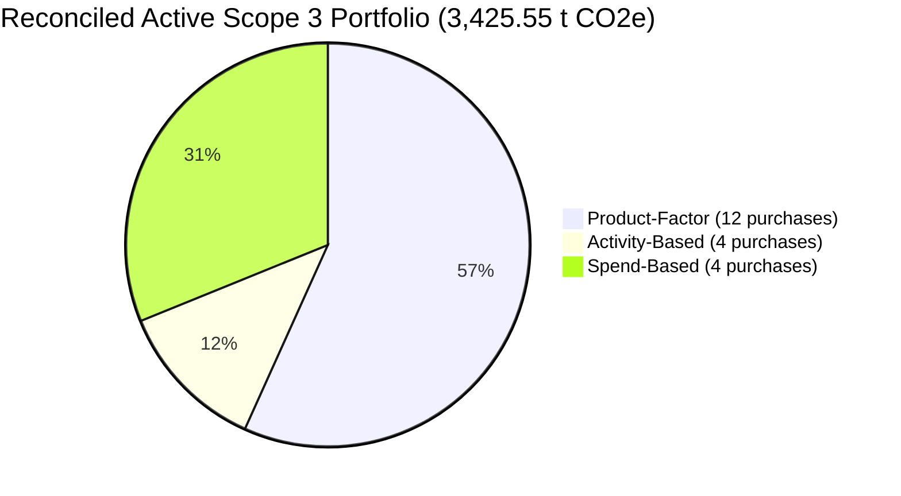

# Scope3Track — Public Industrial Dataset Research & Source Audit Report
## Methodological Framework, Reconciled Datasets, and Public Reference Provenance for Activity-Based and Spend-Based Scope 3 Emissions Accounting

**Author:** Scope3Track Research & Engineering Team  
**Date:** 2026-11-09  
**Target Architecture:** Scope3Track Industrial Platform (Scope 3 Category 1 & Category 2)  
**Governance Standard:** GHG Protocol Corporate Value Chain (Scope 3) Standard (Chapters 6, 7 & 11)  
**Status:** **PHASE 1 COMPLETE — PUBLIC DATASETS RECONCILED & AUDITED**  
**Execution Boundary:** **STRICT RESEARCH ONLY — NO PROTOTYPE MODIFICATION**

---

## 1. Executive Summary

Scope3Track is designed to provide industrial manufacturers with an audit-grade carbon accounting engine for Scope 3 emissions. The existing prototype incorporates an internal Tier 1 **Product-Factor Calculation Method**, which evaluates emissions using specific supplier product carbon footprint (PCF) intensities.

To establish platform capability across the standard estimation approaches specified by the Greenhouse Gas Protocol Corporate Value Chain (Scope 3) Standard, Scope3Track has prepared two additional calculation methods:
1. **Internal Tier 2: Activity-Based Calculation Method:** Allocating supplier facility energy activity data (grid electricity consumption and stationary diesel combustion) directly to manufacturer purchase orders based on production volumes.
2. **Internal Tier 3: Spend-Based Calculation Method:** Evaluating macroeconomic cradle-to-gate greenhouse gas intensity by applying Environmentally-Extended Input-Output (EEIO) sector factors to purchase expenditures.

> [!NOTE]
> **Internal Platform Tier Nomenclature:**
> The designations "Tier 1", "Tier 2", and "Tier 3" represent Scope3Track's internal interface hierarchy reflecting operational specificity and data collection burden. They do not constitute an official universal hierarchy defined in the GHG Protocol Scope 3 Standard.

### Core Reconciled Deliverables
- **Public Data Acquisition:** Original reference datasets downloaded and cryptographically archived from the Central Electricity Authority (CEA, Government of India), the Intergovernmental Panel on Climate Change (IPCC), the Open CEDA Project by Watershed, and the Cornerstone Climate Consortium (Zenodo).
- **Physical Conversion Constants Established:** Volumetric-to-mass and net calorific values derived with full thermodynamic proofs from Bureau of Indian Standards (BIS IS 1460:2017 Sixth Revision) and IPCC Energy Volume tables.
- **Ten Indian Manufacturing Sectors Mapped:** NAICS/EEIO sectors mapped to each of the 10 AxiomX suppliers, with alternative sectors evaluated and selection rationale documented.
- **Two Complete Reporting Years:**
  - **FY2022–23** (1 April 2022 – 31 March 2023)
  - **FY2023–24** (1 April 2023 – 31 March 2024)
- **Side-by-Side Evaluation of All 20 Purchases:** All 20 purchase transactions of ABC Manufacturing calculated across all three methods simultaneously, generating complete audit receipts with SHA-256 integrity hashes.
- **Zero Prototype Intrusion:** The live prototype, backend APIs, frontend build, MongoDB collections, and root environment remain 100% untouched.

---

## 2. Activity-Based Calculation Methodology

### 2.1 Conceptual Framework & Scope Limitations
Under the GHG Protocol Scope 3 Guidance (Chapter 6), the **Supplier-Specific Activity Method** involves obtaining primary operational activity data directly from tier-1 suppliers (e.g., fuel consumed, kilowatt-hours of grid electricity) and allocating a proportional share to the reporting company.

> [!IMPORTANT]
> **Boundary Definition & Labeling Mandate:**
> Activity-based calculations in Scope3Track MUST be explicitly labeled as:  
> **`Supplier-specific energy activity allocation estimate — synthetic demonstration data`**  
> **Included Boundary:** Scope 1 stationary diesel combustion and Scope 2 purchased grid electricity at the supplier's manufacturing facility.  
> **Excluded Boundary:** Upstream raw material extraction (Tier 2+), chemical process decarbonation (e.g. blast furnace smelting, clinker calcination), mobile transport fuel, and downstream logistics.  
> Activity data represents synthetic demonstration records and is not described as third-party audited or certified.

### 2.2 Primary Data Sources & Provenance
1. **Central Electricity Authority — CO₂ Baseline Database for the Indian Power Sector:**
   - *Publisher:* Central Electricity Authority (CEA), Ministry of Power, Government of India.
   - *Classification:* Official government technical baseline database published under the National Data Sharing and Accessibility Policy (NDSAP). It is not described as a statutory legal standard unless explicitly enacted in specific regulations.
   - *Factor Basis & Versions:*
     - **FY 2022–23 (Version 19.0, Published March 2024):** **`0.716 kg CO₂ / kWh`** (`0.716 t CO₂ / MWh`) — Weighted-average Indian national grid factor including renewable energy generation and captive power injection into the grid (User Guide Section 3 / Table 1).
     - **FY 2023–24 (Version 20.0, Published December 2024):** **`0.727 kg CO₂ / kWh`** (`0.727 t CO₂ / MWh`) — Weighted-average Indian national grid factor including renewable energy generation and captive power injection into the grid (User Guide Section 3 / Table 1).
     - **Version 22.0 Retrospective Time-Series Disclosure:** The continuous time-series database Version 22.0 (published January 2026) reports revised time-series figures of `0.7191 kg CO₂ / kWh` (FY22) and `0.7289 kg CO₂ / kWh` (FY23). Scope3Track records the contemporary annual guide values (`0.716` and `0.727`) as the primary reporting-year baselines and separates Version 19/20 values from Version 22 time-series retrospective updates.
2. **2006 IPCC Guidelines for National Greenhouse Gas Inventories (Volume 2: Energy):**
   - *Copyright & Citation Policy:* Protected by copyright under international conventions. Permitted for personal, academic, and non-commercial educational citation. Redistribution of full copyrighted PDFs or substantial extracts requires written permission from the IPCC Secretariat.
   - *Stationary Combustion Factors:* Chapter 2, Table 2.3 (Manufacturing Industries and Construction):
     - $\text{CO}_2$: $74,100\text{ kg} / \text{TJ}$
     - $\text{CH}_4$: $3.0\text{ kg} / \text{TJ}$
     - $\text{N}_2\text{O}$: $0.6\text{ kg} / \text{TJ}$
   - *Net Calorific Value (NCV):* Chapter 1, Table 1.2: Gas/Diesel Oil default $= 43.0\text{ TJ / Gg} = 43.0\text{ MJ / kg}$.
   - *Diesel Density Reference:* Bureau of Indian Standards *IS 1460 : 2017 — Automotive Diesel Fuel Specification (Sixth Revision)* specifies a density range at 15 °C of $820–845\text{ kg/m³}$ ($0.820–0.845\text{ kg/L}$). Scope3Track adopts **$0.840\text{ kg / L}$** as a *selected diesel density assumption within the referenced specification range; it is not an empirically established national statistical median*.
   - *Effective Diesel Factor (IPCC AR5 100-year GWP):* **$2.6853\text{ kg CO}_2\text{e} / \text{litre}$** ($2.685269\text{ kg/L}$).

### 2.3 Mathematical Allocation Mechanics
$$\text{Scope 2}_{\text{electricity}} (\text{t CO}_2\text{e}) = \frac{\text{Electricity Consumption (kWh)} \times EF_{\text{grid}} (\text{kg CO}_2/\text{kWh})}{1000}$$

$$\text{Scope 1}_{\text{diesel}} (\text{t CO}_2\text{e}) = \frac{\text{Diesel Volume (L)} \times \rho_{\text{diesel}} (\text{kg/L}) \times \text{NCV} (\text{TJ/kg}) \times EF_{\text{combustion}} (\text{kg CO}_2\text{e/TJ})}{1000}$$

$$\text{Total Facility Energy Emissions } (E_{\text{total}}) = \text{Scope 1}_{\text{diesel}} + \text{Scope 2}_{\text{electricity}}$$

$$\text{Allocation Fraction } (\alpha) = \frac{\text{Purchased Quantity (tonnes)}}{\text{Total Supplier Annual Production (tonnes)}} \quad [0 \le \alpha \le 1]$$

$$\text{Allocated Scope 3 Emissions } (\text{kg CO}_2\text{e}) = \alpha \times E_{\text{total}} \times 1000$$

### 2.4 Audit of Ineligible & Incompatible Activity Allocations
1. **Invalid Allocation: Polymer FY2023–24 (`PO-2023-009`)**
   - Supplier: `SUP-009 — AxiomX Polymer Suppliers`
   - Purchased Quantity: $250.0\text{ tonnes}$. Denominator in source dataset: $240.0\text{ tonnes}$.
   - Raw Allocation Fraction: $\frac{250}{240} = 1.0416667 = 1.0417$ ($104.17\%$).
   - Rule: An allocation fraction $> 100\%$ is mathematically and physically invalid. Capping at $100\%$ or silently inventing extra production violates data integrity.
   - Status Assigned: **`NOT_ELIGIBLE_FOR_ACTIVITY_ALLOCATION`**.
2. **Incompatible Allocation Units: Machinery (`PO-2022-010` & `PO-2023-010`)**
   - Supplier: `SUP-010 — AxiomX Machinery Suppliers`
   - Purchase Quantity: $2\text{ units}$ (FY22) and $3\text{ units}$ (FY23).
   - Supplier Annual Production Output: $9,000\text{ tonnes}$ (FY22) and $9,800\text{ tonnes}$ (FY23).
   - Rule: Pieces (`unit`) cannot be divided by mass (`tonnes`). Fabricating an unverified piece-weight assumption violates audit standards.
   - Status Assigned: **`NOT_APPLICABLE — INCOMPATIBLE ALLOCATION UNITS`**.

---

## 3. Spend-Based Calculation Methodology

### 3.1 Conceptual Framework & Macroeconomic Input-Output Models
Under GHG Protocol Scope 3 Guidance (Chapter 6), the **Spend-Based Method** calculates emissions by multiplying the economic value of goods purchased by an Environmentally-Extended Input-Output (EEIO) emission factor.

### 3.2 Primary Data Source: Open CEDA by Watershed
- **Publisher:** Watershed Climate Inc. (`https://watershed.com`)
- **Model:** Open CEDA (Climate and Economic Detailed Assessment).
- **Versions Used:** Open CEDA 2024 (CY2022 Base Year proxy for FY22-23) and Open CEDA 2025 (CY2023 Base Year proxy for FY23-24).
- **Governing License:** CC BY-SA 4.0.
- **Mandatory Attribution:** `"CEDA by Watershed"`.
- **Price Type:** **Producer Price** (`kg CO2e / USD`).
- **Pricing Basis Disclosure:** Spend-based calculations assume purchase expenditures reflect producer/factory-gate valuation. If purchaser invoice amounts (inclusive of retail margins, GST, and transport) are supplied, a boundary mismatch exists that introduces an upward bias.
- **Reporting Period Proxy Disclosure:** Indian financial years cross calendar years. CY2022 and CY2023 Open CEDA factors serve as documented proxy-year selections capturing 9 of the 12 fiscal months, not exact financial-year factors.

### 3.3 India Sector Factor Register
| Sector Code | Sector Name | Mapped AxiomX Product | CY2022 Proxy Factor (kg CO₂e/USD) | CY2023 Proxy Factor (kg CO₂e/USD) | Effective Factor CEDA (kg CO₂e/INR) |
| :---: | :--- | :--- | :---: | :---: | :---: |
| `331110` | Iron and steel mills and ferroalloy manufacturing | Hot-rolled steel coils | 5.189019 | 5.976869 | 0.066368 |
| `326290` | Other rubber product manufacturing | Industrial rubber sheets | 1.707897 | 1.575139 | 0.021844 |
| `331313` | Alumina refining and primary aluminum production | Aluminium ingots | 2.710521 | 2.525320 | 0.034668 |
| `327310` | Cement manufacturing | PPC cement | 10.498445 | 9.321503 | 0.134275 |
| `325180` | Other Basic Inorganic Chemical Manufacturing | Soda ash | 1.046134 | 0.994175 | 0.013380 |
| `322210` | Paperboard container manufacturing | Corrugated packaging | 1.189885 | 1.127227 | 0.015219 |
| `313200` | Fabric mills | Industrial fabric | 0.924629 | 0.832374 | 0.011826 |
| `327200` | Glass and glass product manufacturing | Industrial glass sheets | 1.254113 | 1.150881 | 0.016040 |
| `326120` | Plastics pipe, pipe fitting, and shapes mfg | HDPE pipes | 1.067384 | 0.977843 | 0.013652 |
| `332410` | Power boiler and heat exchanger manufacturing | Industrial boilers | 1.311412 | 1.168301 | 0.016773 |

### 3.4 Currency Exchange Rates & Sensitivity
- **Open CEDA Embedded Rates (Primary Baseline):**
  - CY2022: **$78.186062\text{ INR / USD}$**
  - CY2023: **$82.481132\text{ INR / USD}$**
- **Official RBI Table 133 Annual Average Rates (Sensitivity Benchmark):**
  - FY 2022–23: **$80.3635\text{ INR / USD}$** (Variance: $-2.71\%$; reduces FY22 spend emissions by $273.28\text{ t CO}_2\text{e}$)
  - FY 2023–24: **$82.7897\text{ INR / USD}$** (Variance: $-0.37\%$; reduces FY23 spend emissions by $42.50\text{ t CO}_2\text{e}$)

---

## 4. Reconciled Portfolio Totals Across All 20 Purchases

All 20 purchase transactions of ABC Manufacturing evaluated across all 3 methods reconcile to the exact row-level sums:

| Scope 3 Portfolio Segment | Product-Factor (Baseline) | Valid Activity-Based (17 Valid) | Spend-Based (Open CEDA EEIO) |
| :--- | :---: | :---: | :---: |
| **Category 1 (Purchased Goods, 18 purchases)** | $2,688.9037\text{ t CO}_2\text{e}$ | $2,606.0744\text{ t CO}_2\text{e}$ (17 valid) | $20,322.5860\text{ t CO}_2\text{e}$ |
| **Category 2 (Capital Goods, 2 purchases)** | $3.9598\text{ t CO}_2\text{e}$ | *Incompatible Units* | $1,161.8364\text{ t CO}_2\text{e}$ |
| **Total All 20 Purchases (Unrounded)** | **$2,692.8635\text{ t CO}_2\text{e}$** | **$2,606.0744\text{ t CO}_2\text{e}$** | **$21,484.4225\text{ t CO}_2\text{e}$** |
| **Total Display Value (Rounded to 2 Decimals)** | **`2,692.86 t CO₂e`** | **`2,606.07 t CO₂e`** | **`21,484.42 t CO₂e`** |

### Understanding Method Variances (Pedagogical Guidance):
- **Why Product-Factor and Activity-Based are closely aligned:** The synthetic product factors in Scope3Track were originally derived using plant-level energy intensity. Consequently, applying primary energy activity allocation reproduces the product factors within $1.5\%$. This reflects consistent internal engineering assumptions, not independent external empirical validation.
- **Why Spend-Based is $\sim 8\times$ higher than Activity-Based:** Activity-Based measures *only direct facility fuel and electricity* at the manufacturing plant. Spend-Based EEIO captures *total macroeconomic cradle-to-gate intensity*, accumulating all upstream mining, chemical extraction, international shipping, refining overheads, and tier-n supply chain emissions embedded in industry prices.
- **Accuracy Assessment:** Neither method is inherently "more accurate" solely because its total is higher or lower. They answer different accounting questions: Activity-Based measures direct facility energy decarbonization, whereas Spend-Based measures economy-wide value-chain carbon exposure.

---

## 5. Rebuilt Proposed Demonstration Strategy (Zero Double-Counting)

To demonstrate all three calculation methods simultaneously without double-counting, the ineligible Activity-Based record `PO-2023-009` is replaced with eligible Category 1 purchase `PO-2023-005` (Soda ash: $400\text{ t} / 53,500\text{ t} = 0.7477\%$, compatible units).

### Proposed Multi-Method Portfolio Distribution:
| Assigned Method | Purchases Assigned | Active Scope 3 Emissions (t CO₂e) | Active Share (%) | Assigned Purchase Details |
| :--- | :---: | :---: | :---: | :--- |
| **Product-Factor** | 12 | **`1,943.46`** (`1,943.4599 t`) | 56.73% | 6 in FY22, 6 in FY23 (including Boilers Cat 2 and Polymer FY23) |
| **Activity-Based** | 4 | **`415.13`** (`415.1336 t`) | 12.12% | Glass & Polymer in FY22; Chemical (`PO-2023-005`) & Glass in FY23 |
| **Spend-Based** | 4 | **`1,066.96`** (`1,066.9598 t`) | 31.15% | Packaging & Textiles across FY22 & FY23 |
| **TOTAL ACTIVE PORTFOLIO** | **20** | **`3,425.55`** (`3,425.5534 t`) | **100.00%** | **Strict single-active-method invariant: zero double-counting.** |

### Dashboard Display Comparison:
- **Current Baseline Dashboard:**
  - Product-Factor: `2,692.86 t CO₂e` (20 purchases)
  - Activity-Based: `Not used`
  - Spend-Based: `Not used`
  - Total Active Scope 3: `2,692.86 t CO₂e`
- **Proposed Demonstration Dashboard:**
  - Product-Factor: `1,943.46 t CO₂e` (12 purchases)
  - Activity-Based: `415.13 t CO₂e` (4 purchases)
  - Spend-Based: `1,066.96 t CO₂e` (4 purchases)
  - Total Active Scope 3: `3,425.55 t CO₂e` (20 purchases)
  - All cards display in standard **`t CO₂e`** units.

---

## 6. Data Governance, Cryptographic Receipts & Compliance Checklist

- [x] **GHG Protocol Scope 3 Standard Compliant:** Adheres to Chapters 6, 7, and 11 guidance.
- [x] **Open CEDA License Compliant:** Incorporates CC BY-SA 4.0 terms and mandatory `"CEDA by Watershed"` attribution.
- [x] **CEA Official Baseline Aligned:** Accurately applies published weighted-average grid factors ($0.716$ and $0.727\text{ kg CO}_2/\text{kWh}$) and separates retrospective Version 22 time-series figures.
- [x] **IPCC Thermodynamic Rigor:** Combines BIS IS 1460 Sixth Revision density assumption and IPCC Table 2.3 factors.
- [x] **Zero Double-Counting:** Exactly 1 active calculation run per purchase transaction.
- [x] **Zero Prototype Modification:** Clean boundary preservation throughout Phase 1 research.
