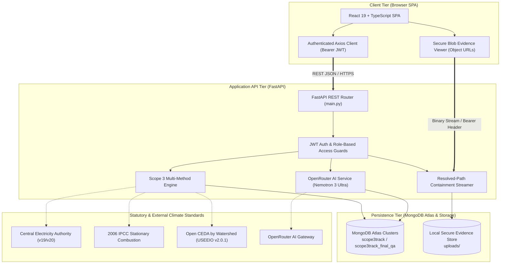
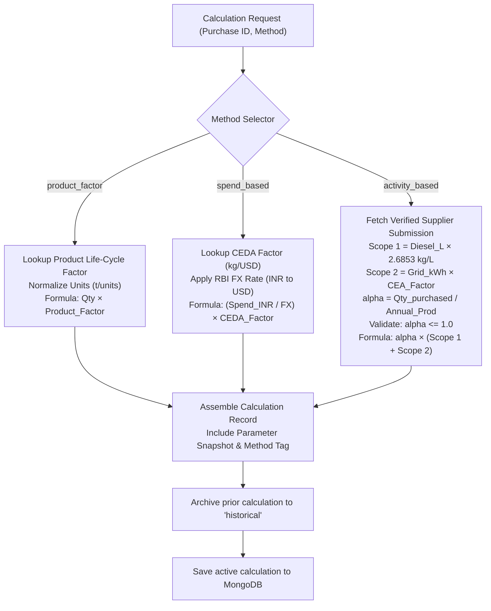
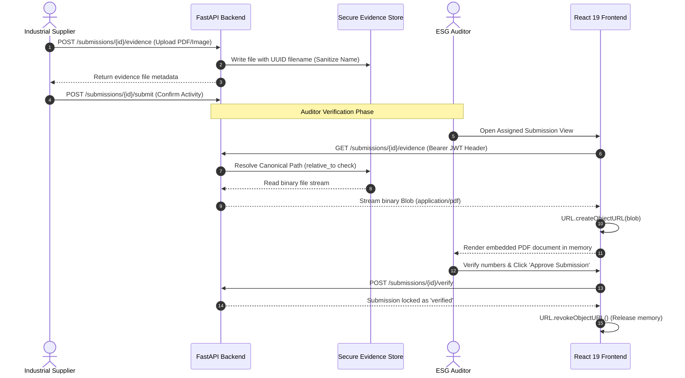

# TraceCarbon — Technical Architecture & Component Specifications

**Platform**: TraceCarbon Scope 3 Management System  
**Organization**: ABC Manufacturing Ltd  
**Version**: v2.10.1  
**Status**: Production & QA Multi-Method Release  

---

## 1. Architectural Overview

TraceCarbon is designed as a modular monorepo containing a modern client SPA (React 19 + TypeScript + Tailwind CSS), a high-concurrency asynchronous API backend (FastAPI + Pydantic + PyMongo), and an enterprise cloud document store (MongoDB Atlas).

### System Topology

---

## 2. Multi-Method Calculation Pipeline

---

## 3. Security & Evidence Management Pipeline

---

## 4. Key Component Responsibilities

1. **`backend/app/main.py`**: Primary entry point containing all REST endpoints, calculation logic, security containment, and OpenRouter integration.
2. **`frontend/src/`**: React 19 application organizing components by domain:
   - `pages/`: Dashboard, Purchases, Suppliers, Submissions, Analytics, Login.
   - `components/`: EvidenceViewerModal, AIMappingModal, QuickPersonaCards, Navbar.
   - `services/api.ts`: Central Axios client configured with Bearer token interceptor and 120s timeout.
3. **`SUPPLIER_ANNUAL_DATASETS_2Y/`**: Standalone repository of 20 supplier-year activity workbooks.
4. **`PUBLIC_DATASET_RESEARCH/`**: Empirical research documentation, generation scripts, and corporate filings.
5. **`docs/reports/`**: Full suite of statutory reports, analytics spreadsheets, and historical verification audits.
