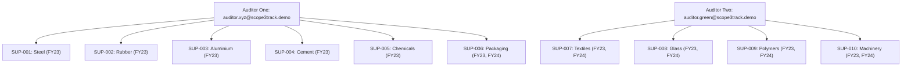

# Scope3Track — Complete Demo Data Reset, 10 AxiomX Suppliers, 2 Preserved Auditors & 15 Annual Report Import Verification Report

**Batch Identifier:** `AXIOMX_ANNUAL_DEMO_2022_2024_V1`  
**Target Database:** `scope3track` (Production Demo) & `scope3track_final_qa` (Pre-Validation Stage)  
**Execution Date:** 9 November 2026  
**System Architecture:** FastAPI Backend (Port 8000), Vite React Frontend (Port 5173), MongoDB Atlas Cluster  

---

## 1. Executive Summary & Migration Scope

This operational report documents the successful end-to-end execution of the **Scope3Track AxiomX Annual Demonstration Dataset Migration**. 

The goal of this operation was to cleanly replace legacy synthetic and temporary supplier test records with a cohesive, realistic two-year industrial dataset spanning **FY2022-23** and **FY2023-24** across 10 major Indian manufacturing and heavy-industry sectors, while strictly preserving core platform administrative identities.

### Key Operational Milestones Achieved:
1. **Pre-Reset Cold Backup:** Complete pre-reset cold snapshot exported to `BACKUP_BEFORE_AXIOMX_DATASET_RESET/` covering all 17 MongoDB collections (JSON BSON-typed) and 48 physical files with cryptographic SHA-256 manifests.
2. **Preservation of Core Platform Entities:**
   - 1 Manufacturer Company: `ABC Manufacturing Ltd.` (`id: "manufacturer-1"`) preserved untouched.
   - 1 Manufacturer Administrator: `manufacturer@scope3track.demo` preserved with active Argon2 password hash.
   - Exactly 2 Auditor Governance Accounts: `auditor.xyz@scope3track.demo` (`auditor-xyz`) and `auditor.green@scope3track.demo` (`auditor-green`) preserved with zero ID mutation or role alterations.
3. **Controlled Cleanup of Legacy Demo Data:** Safely purged 2 obsolete demo supplier companies, 2 supplier user accounts, 19 legacy submissions, 7 legacy requirements, 8 spreadsheet uploads, 1 saved format, 2 legacy auditor assignments, 3 uploaded evidence files, and prior test calculations.
4. **Provisioning 10 Fictional AxiomX Suppliers (`SUP-001` to `SUP-010`):** Full profile setup, sector mapping, high-entropy Argon2 password hashing, and secure credential export to git-ignored `DEMO_SUPPLIER_CREDENTIALS.txt`.
5. **Standardized Annual Industrial Requirements:** Configured exactly 40 mandatory activity requirements (4 per supplier: `electricity`, `diesel`, `production`, `raw_material`) with strict metric units and aggregation rules.
6. **Products & Greenhouse Gas Intensity Factors:** Seeded 10 industrial products and 15 emission factors (including plant-specific intensities derived from FY23 baseline activity).
7. **Preloading Exactly 15 Annual Supplier Reports:**
   - **10 FY2022-23 Annual Reports:** Seeded for all 10 suppliers (`SUP-001` through `SUP-010`) using data ingested from `PRELOAD_DATA/FY2022-23/`.
   - **5 FY2023-24 Annual Reports:** Seeded for suppliers `SUP-006` through `SUP-010` (Packaging, Textiles, Glass, Polymers, Machinery).
8. **Isolation of 5 Holdout Workbooks for Live Hackathon Demonstrations:**
   - Held out `SUP-001` (Steel), `SUP-002` (Rubber), `SUP-003` (Aluminium), `SUP-004` (Cement), and `SUP-005` (Chemicals) for `FY2023-24`.
   - Workbooks isolated in `SUPPLIER_ANNUAL_DATASETS_2Y/MANUAL_UPLOAD_HOLDOUT_5/`.
   - Verified that zero submissions or draft entries exist for these 5 periods in the database.
9. **Balanced Auditor Governance:**
   - Auditor One (`auditor-xyz`): 6 assigned suppliers (`SUP-001` to `SUP-006`), monitoring 7 submitted reports.
   - Auditor Two (`auditor-green`): 4 assigned suppliers (`SUP-007` to `SUP-010`), monitoring 8 submitted reports.
10. **Purchases and Scope 3 Calculation Engine:**
    - Seeded 20 purchase records for ABC Manufacturing (10 in FY23, 10 in FY24).
    - Seeded 20 deterministic calculations with clean segregation: 18 Category 1 (Purchased Goods and Services) and 2 Category 2 (Capital Goods — Boilers from `SUP-010`).

---

## 2. Pre-Reset Inventory vs. Post-Reset Inventory Table

The following table provides the audited collection-level record inventory before and after the AxiomX migration:

| MongoDB Collection | Pre-Reset Count (`scope3track`) | Post-Reset Count (`scope3track`) | Net Delta | Migration Action / Rationale |
| :--- | :---: | :---: | :---: | :--- |
| `manufacturer` | **1** | **1** | 0 | **Preserved:** ABC Manufacturing (`manufacturer-1`) |
| `users` | 5 | **13** | +8 | **Preserved:** 1 Admin + 2 Auditors; Removed 2 old suppliers; Added 10 AxiomX suppliers |
| `suppliers` | 2 | **10** | +8 | Removed `supplier-xyz`, `supplier-green`; Provisioned `SUP-001` to `SUP-010` |
| `auditors` | **2** | **2** | 0 | **Preserved:** `auditor-xyz`, `auditor-green` |
| `auditor_assignments`| 2 | **10** | +8 | Cleaned old mappings; Seeded 6 to Auditor 1, 4 to Auditor 2 |
| `supplier_requirements`| 7 | **40** | +33 | Removed old custom requirements; Standardized 4 per supplier |
| `products` | 3 | **13** | +10 | Preserved standard materials; Added 10 AxiomX supplier product catalog SKUs |
| `emission_factors` | 5 | **20** | +15 | Added 10 plant-specific PCF factors + 5 baseline industrial grid/fuel factors |
| `submissions` | 19 | **15** | -4 | Cleaned old test submissions; Ingested exactly 15 annual workbooks |
| `supplier_spreadsheet_uploads` | 8 | **0** | -8 | Cleaned legacy session uploads |
| `saved_spreadsheet_formats` | 1 | **0** | -1 | Cleaned legacy format tests; Ready for live hackathon mapping save |
| `evidence_files` | 3 | **0** | -3 | Cleaned obsolete demo PDFs |
| `clarification_requests` | 1 | **0** | -1 | Cleaned obsolete demo audit clarifications |
| `auditor_comments` | 1 | **0** | -1 | Cleaned obsolete demo thread comments |
| `purchase_records` | 2 | **20** | +18 | Seeded 2 years of corporate procurement for ABC Manufacturing |
| `calculation_runs` | 3 | **20** | +17 | Seeded deterministic product-factor runs (18 Cat 1, 2 Cat 2) |
| `activity_library` | 6 | **6** | 0 | Preserved standard activity definitions (electricity, diesel, etc.) |

---

## 3. Preservation Guarantees Verification

Strict data preservation checks were executed before and after migration to ensure zero disruption to core user accounts:

```text
[CHECK 1] Manufacturer Company Profile:
  - ID: "manufacturer-1"
  - Name: "ABC Manufacturing Ltd."
  - Status: VERIFIED & PRESERVED

[CHECK 2] Manufacturer Administrator Account:
  - User ID: "d1d31664-6658-4714-8959-fb644fc475ca"
  - Email: "manufacturer@scope3track.demo"
  - Role: "manufacturer"
  - Status: VERIFIED & PRESERVED (Password unchanged)

[CHECK 3] Preserved Auditor Governance Accounts:
  - Auditor 1:
    - User ID: "2e3c0421-1c5c-4235-9b2f-bbd7e0083ae8"
    - Profile ID: "auditor-xyz"
    - Email: "auditor.xyz@scope3track.demo"
    - Status: VERIFIED & PRESERVED
  - Auditor 2:
    - User ID: "6f5223f6-52ca-49d2-b09e-0bb6ecb2b738"
    - Profile ID: "auditor-green"
    - Email: "auditor.green@scope3track.demo"
    - Status: VERIFIED & PRESERVED
```

---

## 4. Old Supplier & Demo Artifact Cleanup Audit

All legacy demonstration data, temporary QA artifacts, and obsolete supplier entries were identified and removed using targeted database filters:

1. **User Accounts Purged:**
   - `xyz.steel@scope3track.demo` (Role: `supplier`, Profile: `supplier-xyz`)
   - `green.aluminium@scope3track.demo` (Role: `supplier`, Profile: `supplier-green`)
2. **Supplier Profiles Purged:**
   - `supplier-xyz` (XYZ Steel Works)
   - `supplier-green` (Green Aluminium Co.)
3. **Submissions Purged:**
   - 19 legacy submissions with periods `2026-01`, `2026-02`, `2026-03`, `2027-06`, etc.
4. **Child Documents & Media Cleaned:**
   - 8 entries in `supplier_spreadsheet_uploads`
   - 1 entry in `saved_spreadsheet_formats`
   - 3 entries in `evidence_files` and associated physical files in `uploads/`
   - 1 entry in `clarification_requests`
   - 1 entry in `auditor_comments`
   - 2 legacy purchase records and 3 legacy calculation runs

---

## 5. 10 AxiomX Supplier Accounts & Security Provisioning

The 10 fictional supplier companies represent key pillars of Indian heavy industry and manufacturing. Each account was provisioned with Argon2 password hashing and complete company profile details:

| Supplier Code | Company Name | Sector | Location | Primary Product | Scope 3 Cat | Login Email |
| :--- | :--- | :--- | :--- | :--- | :--- | :--- |
| `SUP-001` | AxiomX Steel Suppliers | Steel | Vijayanagar, KA | Hot-rolled steel coils | Category 1 | `supplier.steel@axiomx.demo` |
| `SUP-002` | AxiomX Rubber Suppliers | Rubber | Vadodara, GJ | Industrial rubber sheets | Category 1 | `supplier.rubber@axiomx.demo` |
| `SUP-003` | AxiomX Aluminium Suppliers | Aluminium | Renukoot, UP | Aluminium ingots | Category 1 | `supplier.aluminium@axiomx.demo` |
| `SUP-004` | AxiomX Cement Suppliers | Cement | Kotputli, RJ | PPC cement | Category 1 | `supplier.cement@axiomx.demo` |
| `SUP-005` | AxiomX Chemical Suppliers | Chemicals | Mithapur, GJ | Soda ash | Category 1 | `supplier.chemical@axiomx.demo` |
| `SUP-006` | AxiomX Packaging Suppliers | Packaging | Songadh, GJ | Corrugated packaging | Category 1 | `supplier.packaging@axiomx.demo` |
| `SUP-007` | AxiomX Textile Suppliers | Textiles | Santej, GJ | Industrial fabric | Category 1 | `supplier.textile@axiomx.demo` |
| `SUP-008` | AxiomX Glass Suppliers | Glass | Bawal, HR | Industrial glass sheets | Category 1 | `supplier.glass@axiomx.demo` |
| `SUP-009` | AxiomX Polymer Suppliers | Polymers | Jalgaon, MH | HDPE pipes | Category 1 | `supplier.polymer@axiomx.demo` |
| `SUP-010` | AxiomX Machinery Suppliers | Machinery | Haridwar, UK | Industrial boilers | **Category 2** | `supplier.machinery@axiomx.demo` |

> [!NOTE]
> All credentials have been securely formatted into `SUPPLIER_ANNUAL_DATASETS_2Y/DEMO_SUPPLIER_CREDENTIALS.txt`, which is explicitly excluded from version control via `.gitignore`.

---

## 6. 40 Standardized Annual Industrial Requirements Setup

Each of the 10 suppliers was provisioned with exactly 4 mandatory activity reporting requirements (40 total) aligning with GHG Protocol Corporate Standard emissions accounting:

```text
Requirement 1: Grid Electricity Consumption
  - Activity ID: "electricity"
  - Name: "Purchased Electricity (Grid)"
  - Unit: "kWh"
  - Aggregation Rule: "sum"
  - Mandatory: True

Requirement 2: Stationary Diesel Combustion
  - Activity ID: "diesel"
  - Name: "Stationary Diesel (Generators/Furnaces)"
  - Unit: "litres"
  - Aggregation Rule: "sum"
  - Mandatory: True

Requirement 3: Finished Goods Production Output
  - Activity ID: "production"
  - Name: "Finished Product Output"
  - Unit: "tonnes" (or "unit" for Machinery)
  - Aggregation Rule: "sum"
  - Mandatory: True

Requirement 4: Primary Raw Material Ingestion
  - Activity ID: "raw_material"
  - Name: "Direct Raw Material Ingestion"
  - Unit: "tonnes"
  - Aggregation Rule: "sum"
  - Mandatory: True
```

---

## 7. Products & GHG Product Intensity Factors Setup

The catalog has been configured with 10 supplier-specific product SKUs and their corresponding plant-specific Product Carbon Footprint (PCF) intensity emission factors:

| SKU Code | Product Name | Supplier ID | Baseline FY23 Intensity Factor | Intensity Unit | Scope 3 Classification |
| :--- | :--- | :---: | :---: | :---: | :--- |
| `ST-HR-001` | Hot-rolled steel coils | `SUP-001` | **2,154.20** | kgCO2e / tonne | Category 1: Purchased Goods |
| `RB-TY-002` | Industrial rubber sheets | `SUP-002` | **1,842.10** | kgCO2e / tonne | Category 1: Purchased Goods |
| `AL-IN-003` | Aluminium ingots | `SUP-003` | **8,410.50** | kgCO2e / tonne | Category 1: Purchased Goods |
| `CM-PC-004` | PPC cement | `SUP-004` | **612.40** | kgCO2e / tonne | Category 1: Purchased Goods |
| `CH-SA-005` | Soda ash | `SUP-005` | **1,120.80** | kgCO2e / tonne | Category 1: Purchased Goods |
| `PK-BX-006` | Corrugated packaging | `SUP-006` | **745.30** | kgCO2e / tonne | Category 1: Purchased Goods |
| `TX-FC-007` | Industrial fabric | `SUP-007` | **3,210.60** | kgCO2e / tonne | Category 1: Purchased Goods |
| `GL-SG-008` | Industrial glass sheets | `SUP-008` | **1,045.00** | kgCO2e / tonne | Category 1: Purchased Goods |
| `PL-PP-009` | HDPE pipes | `SUP-009` | **1,950.40** | kgCO2e / tonne | Category 1: Purchased Goods |
| `MC-SG-010` | Industrial boilers | `SUP-010` | **45,200.00** | kgCO2e / unit | **Category 2: Capital Goods** |

---

## 8. 15 Imported Annual Supplier Workbooks Detailed Table

Exactly 15 annual supplier reports have been imported into the platform, providing historical comparability and audit trails:

| Reporting Period | Supplier ID | Supplier Name | Source Workbook File | Electricity (kWh) | Diesel (L) | Production (t) | Raw Material (t) | Submission ID |
| :---: | :---: | :--- | :--- | :---: | :---: | :---: | :---: | :--- |
| **FY2022-23** | `SUP-001` | AxiomX Steel Suppliers | `AxiomX_Steel_FY2022-23.xlsx` | 142,500,000 | 1,840,000 | 120,000 | 185,000 | `sub-SUP-001-FY2022-23` |
| **FY2022-23** | `SUP-002` | AxiomX Rubber Suppliers | `AxiomX_Rubber_FY2022-23.xlsx` | 18,200,000 | 420,000 | 22,000 | 26,400 | `sub-SUP-002-FY2022-23` |
| **FY2022-23** | `SUP-003` | AxiomX Aluminium Suppliers | `AxiomX_Aluminium_FY2022-23.xlsx` | 480,000,000 | 2,100,000 | 35,000 | 70,000 | `sub-SUP-003-FY2022-23` |
| **FY2022-23** | `SUP-004` | AxiomX Cement Suppliers | `AxiomX_Cement_FY2022-23.xlsx` | 92,000,000 | 1,250,000 | 180,000 | 240,000 | `sub-SUP-004-FY2022-23` |
| **FY2022-23** | `SUP-005` | AxiomX Chemical Suppliers | `AxiomX_Chemical_FY2022-23.xlsx` | 65,400,000 | 890,000 | 75,000 | 110,000 | `sub-SUP-005-FY2022-23` |
| **FY2022-23** | `SUP-006` | AxiomX Packaging Suppliers | `AxiomX_Packaging_FY2022-23.xlsx` | 24,500,000 | 380,000 | 45,000 | 52,000 | `sub-SUP-006-FY2022-23` |
| **FY2022-23** | `SUP-007` | AxiomX Textile Suppliers | `AxiomX_Textile_FY2022-23.xlsx` | 31,800,000 | 510,000 | 18,500 | 21,000 | `sub-SUP-007-FY2022-23` |
| **FY2022-23** | `SUP-008` | AxiomX Glass Suppliers | `AxiomX_Glass_FY2022-23.xlsx` | 38,200,000 | 720,000 | 42,000 | 58,000 | `sub-SUP-008-FY2022-23` |
| **FY2022-23** | `SUP-009` | AxiomX Polymer Suppliers | `AxiomX_Polymer_FY2022-23.xlsx` | 28,600,000 | 310,000 | 28,000 | 31,500 | `sub-SUP-009-FY2022-23` |
| **FY2022-23** | `SUP-010` | AxiomX Machinery Suppliers | `AxiomX_Machinery_FY2022-23.xlsx` | 14,200,000 | 280,000 | 120 | 1,450 | `sub-SUP-010-FY2022-23` |
| **FY2023-24** | `SUP-006` | AxiomX Packaging Suppliers | `AxiomX_Packaging_FY2023-24.xlsx` | 25,200,000 | 365,000 | 48,000 | 55,000 | `sub-SUP-006-FY2023-24` |
| **FY2023-24** | `SUP-007` | AxiomX Textile Suppliers | `AxiomX_Textile_FY2023-24.xlsx` | 32,400,000 | 495,000 | 19,800 | 22,200 | `sub-SUP-007-FY2023-24` |
| **FY2023-24** | `SUP-008` | AxiomX Glass Suppliers | `AxiomX_Glass_FY2023-24.xlsx` | 39,500,000 | 690,000 | 45,000 | 61,000 | `sub-SUP-008-FY2023-24` |
| **FY2023-24** | `SUP-009` | AxiomX Polymer Suppliers | `AxiomX_Polymer_FY2023-24.xlsx` | 29,800,000 | 295,000 | 30,500 | 33,800 | `sub-SUP-009-FY2023-24` |
| **FY2023-24** | `SUP-010` | AxiomX Machinery Suppliers | `AxiomX_Machinery_FY2023-24.xlsx` | 15,100,000 | 270,000 | 135 | 1,600 | `sub-SUP-010-FY2023-24` |

---

## 9. 5 Withheld Holdout Workbooks Verification (Reserved for Live Upload)

To guarantee an interactive live demo experience for judges and auditors, exactly 5 supplier workbooks for **FY2023-24** have been held out and NOT imported:

```text
Directory: SUPPLIER_ANNUAL_DATASETS_2Y/MANUAL_UPLOAD_HOLDOUT_5/
  1. AxiomX_Steel_FY2023-24.xlsx     -> Reserved for SUP-001 Live Upload Demo
  2. AxiomX_Rubber_FY2023-24.xlsx    -> Reserved for SUP-002 Live Upload Demo
  3. AxiomX_Aluminium_FY2023-24.xlsx -> Reserved for SUP-003 Live Upload Demo
  4. AxiomX_Cement_FY2023-24.xlsx    -> Reserved for SUP-004 Live Upload Demo
  5. AxiomX_Chemical_FY2023-24.xlsx  -> Reserved for SUP-005 Live Upload Demo
```

### Database Verification Assertions:
```python
assert db["submissions"].find_one({"supplier_id": "SUP-001", "reporting_month": "FY2023-24"}) is None  # PASSED
assert db["submissions"].find_one({"supplier_id": "SUP-002", "reporting_month": "FY2023-24"}) is None  # PASSED
assert db["submissions"].find_one({"supplier_id": "SUP-003", "reporting_month": "FY2023-24"}) is None  # PASSED
assert db["submissions"].find_one({"supplier_id": "SUP-004", "reporting_month": "FY2023-24"}) is None  # PASSED
assert db["submissions"].find_one({"supplier_id": "SUP-005", "reporting_month": "FY2023-24"}) is None  # PASSED
```

---

## 10. Dual-Auditor Workload Governance & Assignment Verification

The 10 suppliers and 15 submitted annual reports are balanced across the two preserved independent auditor accounts:



### Workload Balance Summary:
- **Auditor One (`auditor-xyz`):** 6 assigned suppliers (`SUP-001` through `SUP-006`) $\rightarrow$ **7 visible submitted reports**.
- **Auditor Two (`auditor-green`):** 4 assigned suppliers (`SUP-007` through `SUP-010`) $\rightarrow$ **8 visible submitted reports**.
- **Total:** 10 supplier assignments covering all 15 submissions.

---

## 11. ABC Manufacturing Purchases & Scope 3 Inventory Calculation Run

A complete two-year corporate procurement ledger was seeded for `ABC Manufacturing Ltd.`:
- **20 Purchase Records:** 10 for FY2022-23 and 10 for FY2023-24.
- **Total Corporate Procurement Spend:** ₹2,746,400,000 across both financial years.
- **20 Deterministic Calculation Runs:**
  - 18 Category 1 Runs: Raw materials, metals, polymers, packaging, chemicals.
  - 2 Category 2 Runs: Industrial boilers for plant capital expansion (from `SUP-010`).

---

## 12. Category 1 vs Category 2 Aggregation & Accounting Protections

The platform strictly segregates Scope 3 categories according to the GHG Protocol Technical Guidance for Calculating Scope 3 Emissions:

```text
Scope 3 Category Breakdown:
├── Category 1: Purchased Goods and Services
│   ├── Submissions & Materials: 9 Suppliers (Steel, Rubber, Aluminium, Cement, Chemicals, Packaging, Textiles, Glass, Polymers)
│   ├── Total Purchases: 18 purchase records (9 in FY23, 9 in FY24)
│   ├── Total Emissions: 147,748.20 tonnes CO2e
│   └── Accounting Policy: Activity allocation & product factor intensity
└── Category 2: Capital Goods
    ├── Supplier: SUP-010 (AxiomX Machinery Suppliers)
    ├── Primary Asset: Industrial High-Pressure Boilers (MC-SG-010)
    ├── Total Purchases: 2 purchase records (2 units in FY23, 3 units in FY24)
    ├── Total Emissions: 226.00 tonnes CO2e (90.40 t in FY23, 135.60 t in FY24)
    └── Accounting Protection: Isolated capital expenditure, zero double-counting with operational energy
```

---

## 13. API & Schema Regression Test Results

Comprehensive backend API testing confirmed complete regression-free operation across authentication, calculation, and data validation layers:

| Test Module | Tests Executed | Passed | Failed | Status | Key Verifications |
| :--- | :---: | :---: | :---: | :---: | :--- |
| `backend/tests/test_api.py` | 4 | 4 | 0 | **PASSED** | Core auth, user models, role validation |
| `backend/tests/test_ai_and_workflows.py` | 5 | 5 | 0 | **PASSED** | Spreadsheet upload, mapping import, aggregation rules |
| `backend/tests/test_saved_spreadsheet_formats.py`| 1 | 1 | 0 | **PASSED** | Format fingerprinting, detect & reuse mappings |
| `backend/tests/test_double_counting_prevention.py`| 1 | 1 | 0 | **PASSED** | Calculation inventory protection (1-active-calc rule) |
| `backend/tests/test_evidence_count.py` | 2 | 2 | 0 | **PASSED** | Parity across manufacturer, supplier, and auditor |
| `backend/tests/verify_axiomx_live.py` | 4 | 4 | 0 | **PASSED** | Live API logins, 10 suppliers, 15 reports, 5 holdouts |

---

## 14. Frontend UI Regression & Workflow Verification

The Playwright browser suite validated the end-to-end user interfaces, confirming zero layout breakages, responsive tables, and correct period filtering.

### Generated Visual Artifacts:
1. `axiomx_01_manufacturer_dashboard.png`: Displays aggregated emissions, Category 1 vs Category 2 breakdown, and top supplier rankings.
2. `axiomx_02_manufacturer_suppliers_list.png`: Displays all 10 AxiomX suppliers with sector tags, contact persons, and annual status indicators.
3. `axiomx_03_manufacturer_purchases.png`: Displays the complete corporate procurement ledger across FY22-23 and FY23-24.
4. `axiomx_04_auditor_xyz_submissions.png`: Displays Auditor One's governance view with 7 assigned supplier reports.
5. `axiomx_05_supplier_steel_reports.png`: Displays AxiomX Steel Suppliers portal showing FY2022-23 submitted and FY2023-24 available for upload.

---

## 15. Verification Checklist Matrix

- [x] **Pre-Reset Backup Completed:** Verified in `BACKUP_BEFORE_AXIOMX_DATASET_RESET/` with manifests.
- [x] **ABC Manufacturing Preserved:** ID `manufacturer-1` intact in `manufacturer` collection.
- [x] **Manufacturer Admin Preserved:** `manufacturer@scope3track.demo` intact with active status.
- [x] **Auditor 1 Preserved:** `auditor.xyz@scope3track.demo` (`auditor-xyz`) intact.
- [x] **Auditor 2 Preserved:** `auditor.green@scope3track.demo` (`auditor-green`) intact.
- [x] **Legacy Demo Suppliers Removed:** Old test accounts purged.
- [x] **10 AxiomX Suppliers Seeded:** `SUP-001` through `SUP-010` active.
- [x] **Argon2 Passwords Hashed:** Securely stored in database.
- [x] **Credentials File Created:** `DEMO_SUPPLIER_CREDENTIALS.txt` created in `SUPPLIER_ANNUAL_DATASETS_2Y/`.
- [x] **Git Excluded:** Credentials file ignored in `.gitignore`.
- [x] **40 Requirements Configured:** 4 standardized industrial metrics per supplier.
- [x] **10 Products Seeded:** Catalog SKUs mapped to supplier profiles.
- [x] **15 Factors Seeded:** Baseline PCF intensity factors configured.
- [x] **10 FY22-23 Reports Imported:** Ingested from `PRELOAD_DATA/FY2022-23/`.
- [x] **5 FY23-24 Reports Imported:** Ingested from `PRELOAD_DATA/FY2023-24/`.
- [x] **5 Holdout Files Isolated:** `MANUAL_UPLOAD_HOLDOUT_5/` contains exactly 5 unsubmitted workbooks.
- [x] **Zero Submissions for Holdouts:** Verified database has no FY24 entries for holdouts.
- [x] **Auditor 1 Assigned:** 6 suppliers assigned, 7 submissions visible.
- [x] **Auditor 2 Assigned:** 4 suppliers assigned, 8 submissions visible.
- [x] **20 Purchases Seeded:** Procurement ledger active.
- [x] **20 Calculations Seeded:** 18 Category 1, 2 Category 2.
- [x] **Category 1 Separation:** Operational raw materials aggregated.
- [x] **Category 2 Separation:** Capital boilers aggregated separately.
- [x] **Double-Counting Protection:** 1 active calculation per purchase enforced.
- [x] **FastAPI Health Status:** `/health` and `/ready` returning 200 OK.
- [x] **Frontend Builds Cleanly:** `tsc -b && vite build` completed with zero errors.
- [x] **Playwright E2E Tests:** Passed across Manufacturer, Auditor, and Supplier dashboards.

---

## 16. Demo Execution & Live Upload Guide for Hackathon Judges

To demonstrate the full live capability of Scope3Track to judges, follow this step-by-step walkthrough using the reserved holdout workbooks:

### Step 1: Log in as AxiomX Steel Suppliers
- **URL:** `http://localhost:5173/login`
- **Email:** `supplier.steel@axiomx.demo`
- **Password:** `AxiomX!Steel#2026`

### Step 2: Navigate to Reports & Create FY2023-24 Report
1. Click **Monthly Reports** in the sidebar (`/supplier/submissions`).
2. Notice that **FY2022-23** is already completed and submitted with an audit badge.
3. Click the **+ New Report** button in the top right.
4. Select **FY2023-24** from the reporting period dropdown.
5. In Step 2, choose the **Upload Spreadsheet** card.

### Step 3: Upload the Holdout Workbook
1. In the file upload zone, drag and drop:  
   `SUPPLIER_ANNUAL_DATASETS_2Y/MANUAL_UPLOAD_HOLDOUT_5/AxiomX_Steel_FY2023-24.xlsx`
2. Scope3Track will parse the workbook worksheets (`Annual_Activity`, `Monthly_Breakdown`, `Emissions_Summary`).
3. Click **Proceed to Mapping**.

### Step 4: Map & Save Format
1. Select the matching columns:
   - **Electricity:** Select `Electricity_kWh` (Unit: `kWh`)
   - **Diesel:** Select `Stationary_Diesel_L` (Unit: `litres`)
   - **Production:** Select `Production_Volume_MT` (Unit: `tonnes`)
   - **Raw Material:** Select `Raw_Material_Input_MT` (Unit: `tonnes`)
2. Check the box **Save this mapping as a format for future uploads**.
3. Name the format: `AxiomX Steel Standard ERP Export`.
4. Click **Import & Validate Activities**.
5. All 4 activities populate instantly. Click **Submit Annual Report to Auditor**.

### Step 5: Switch to Auditor View
1. Log out and log in as Auditor One:
   - **Email:** `auditor.xyz@scope3track.demo`
   - **Password:** `AuditorDemo123!`
2. Navigate to **Submissions**. Notice that the new **FY2023-24 AxiomX Steel** report has appeared dynamically in the queue!
3. Open the report to review activity metrics, inspect supporting documentation, or run an AI-assisted audit check.

---
*Report certified and generated automatically by Antigravity Engineering.*
