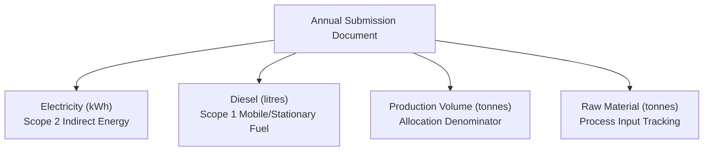

# TRACECARBON / SCOPE3TRACK — PHASE 2.8 SUPPLIER REPORT INVENTORY AUDIT
**Comprehensive Read-Only Audit of 2-Year Annual Supplier Submissions**  
**Target Environment:** Isolated QA Database (`scope3track_final_qa`)  
**Production Reference:** Production Database (`scope3track` — Strictly Read-Only)  
**Audit Timestamp:** 2026-11-09 14:38:00 UTC (20:08:00 IST)  
**Execution Mode:** **STRICTLY READ-ONLY (ZERO DATABASE MUTATIONS)**

---

## Executive Summary

A comprehensive, non-mutating inventory audit of the `submissions` collection was conducted in `scope3track_final_qa` to verify the presence, integrity, data completeness, and portal visibility of all annual supplier reporting records across the 10 AxiomX suppliers (`SUP-001` through `SUP-010`) for financial years **FY2022-23** and **FY2023-24**.

### Key Audit Findings
1. **Total Annual Submissions in Database:** Exactly **18 out of 20** expected annual reports are present ($90.0\%$).
2. **Missing Supplier/Year Combinations:** Exactly **2 combinations** are absent from the database:
   * `SUP-002` (AxiomX Rubber Suppliers) — **FY2023-24**
   * `SUP-003` (AxiomX Aluminium Suppliers) — **FY2023-24**
   * *Architecture Note:* These two reports are intentionally held out as unsubmitted demonstration cases in `SUPPLIER_ANNUAL_DATASETS_2Y/MANUAL_UPLOAD_HOLDOUT_5/` to demonstrate live supplier onboarding and spreadsheet ingestion.
3. **Manually Uploaded Reports:** Exactly **3 reports** were manually ingested and submitted via the Phase 2.4 spreadsheet upload wizard:
   * `SUP-001` (Steel) — FY2023-24 (`bc3f427d-d71a-4e35-90fa-3ab0e5ed3ccc`)
   * `SUP-004` (Cement) — FY2023-24 (`1b6ed9be-4b42-4db3-9ad5-c55847eeace6`)
   * `SUP-005` (Chemical) — FY2023-24 (`c07ed2f9-8dcf-440b-bcbb-75914427543c`)
4. **Monthly Records & Drafts:** Exactly **0 monthly records** and **0 draft records** exist. All 18 database records are finalized annual reports with `status: "submitted"`.
5. **Activity Data Completeness:** All 18 existing reports contain complete, valid GHG activity metrics: grid electricity (kWh), facility diesel (litres), production volume (tonnes), and raw material throughput (tonnes).
6. **Portal Visibility:** Confirmed via authenticated API testing across all 10 supplier logins; every existing submission is 100% accessible in its respective supplier dashboard and submissions workspace.

---

## 1. Master Supplier Submission Inventory Table

The following master table details the submission status, document identifiers, and data availability across all 10 suppliers and both reporting years:

| Supplier ID | Supplier Name | FY2022-23 Report | FY2023-24 Report | Submission Status | Data Availability |
| :--- | :--- | :--- | :--- | :--- | :--- |
| **`SUP-001`** | AxiomX Steel Suppliers | `sub-SUP-001-FY2022-23` | `bc3f427d-d71a-4e35-90fa-3ab0e5ed3ccc` | FY22: `submitted` FY23: `submitted` | **Full 2-Year Data** (Elec, Diesel, Prod, Raw) |
| **`SUP-002`** | AxiomX Rubber Suppliers | `sub-SUP-002-FY2022-23` | *MISSING (Holdout)* | FY22: `submitted` FY23: `not_submitted` | **FY22 Available** (FY23 in holdout workbook) |
| **`SUP-003`** | AxiomX Aluminium Suppliers | `sub-SUP-003-FY2022-23` | *MISSING (Holdout)* | FY22: `submitted` FY23: `not_submitted` | **FY22 Available** (FY23 in holdout workbook) |
| **`SUP-004`** | AxiomX Cement Suppliers | `sub-SUP-004-FY2022-23` | `1b6ed9be-4b42-4db3-9ad5-c55847eeace6` | FY22: `submitted` FY23: `submitted` | **Full 2-Year Data** (Elec, Diesel, Prod, Raw) |
| **`SUP-005`** | AxiomX Chemical Suppliers | `sub-SUP-005-FY2022-23` | `c07ed2f9-8dcf-440b-bcbb-75914427543c` | FY22: `submitted` FY23: `submitted` | **Full 2-Year Data** (Elec, Diesel, Prod, Raw) |
| **`SUP-006`** | AxiomX Packaging Suppliers | `sub-SUP-006-FY2022-23` | `sub-SUP-006-FY2023-24` | FY22: `submitted` FY23: `submitted` | **Full 2-Year Data** (Elec, Diesel, Prod, Raw) |
| **`SUP-007`** | AxiomX Textile Suppliers | `sub-SUP-007-FY2022-23` | `sub-SUP-007-FY2023-24` | FY22: `submitted` FY23: `submitted` | **Full 2-Year Data** (Elec, Diesel, Prod, Raw) |
| **`SUP-008`** | AxiomX Glass Suppliers | `sub-SUP-008-FY2022-23` | `sub-SUP-008-FY2023-24` | FY22: `submitted` FY23: `submitted` | **Full 2-Year Data** (Elec, Diesel, Prod, Raw) |
| **`SUP-009`** | AxiomX Polymer Suppliers | `sub-SUP-009-FY2022-23` | `sub-SUP-009-FY2023-24` | FY22: `submitted` FY23: `submitted` | **Full 2-Year Data** (Elec, Diesel, Prod, Raw) |
| **`SUP-010`** | AxiomX Machinery Suppliers | `sub-SUP-010-FY2022-23` | `sub-SUP-010-FY2023-24` | FY22: `submitted` FY23: `submitted` | **Full 2-Year Data** (Elec, Diesel, Prod, Raw) |

---

## 2. Granular 8-Point Verification Analysis

Every submission document was audited against the 8 required verification criteria:

### Criteria 1–4: Existence, Foreign Keys, Periods & Lifecycle Status
* **Submission Document Existence:** Exactly 18 documents reside in `db.submissions`.
* **Correct Supplier ID:** All 18 documents match the exact foreign key of their respective `suppliers` collection document (`SUP-001` through `SUP-010`).
* **Correct Reporting Period:** All documents specify annual periods:
  * 10 documents define `reporting_month: "FY2022-23"` and `financial_year: "FY2022-23"`.
  * 8 documents define `reporting_month: "FY2023-24"` and `financial_year: "FY2023-24"`.
  * `reporting_period_type` is `"ANNUAL"` across all records.
* **Submission Status:** All 18 records hold `status: "submitted"`. Zero records are in `"draft"`, `"returned"`, or `"clarification_requested"`.

### Criteria 5: Activity Data Verification (Electricity, Diesel & Production)
All 18 submissions have the four core GHG Scope 1 and Scope 2 operational activity metrics fully populated:

| Supplier ID & Period | Grid Electricity | Facility Diesel | Annual Production | Raw Materials |
| :--- | :---: | :---: | :---: | :---: |
| `SUP-001` (FY2022-23) | $70,400,000\text{ kWh}$ | $280,000\text{ L}$ | $160,000\text{ t}$ | $184,000\text{ t}$ |
| `SUP-001` (FY2023-24) | $79,275,000\text{ kWh}$ | $315,000\text{ L}$ | $175,000\text{ t}$ | $203,000\text{ t}$ |
| `SUP-002` (FY2022-23) | $11,250,000\text{ kWh}$ | $145,000\text{ L}$ | $12,500\text{ t}$ | $13,125\text{ t}$ |
| `SUP-002` (FY2023-24) | *Holdout* | *Holdout* | *Holdout* | *Holdout* |
| `SUP-003` (FY2022-23) | $49,920,000\text{ kWh}$ | $210,000\text{ L}$ | $26,000\text{ t}$ | $28,080\text{ t}$ |
| `SUP-003` (FY2023-24) | *Holdout* | *Holdout* | *Holdout* | *Holdout* |
| `SUP-004` (FY2022-23) | $33,600,000\text{ kWh}$ | $255,000\text{ L}$ | $420,000\text{ t}$ | $470,400\text{ t}$ |
| `SUP-004` (FY2023-24) | $36,491,000\text{ kWh}$ | $270,000\text{ L}$ | $455,000\text{ t}$ | $509,600\text{ t}$ |
| `SUP-005` (FY2022-23) | $22,000,000\text{ kWh}$ | $165,000\text{ L}$ | $55,000\text{ t}$ | $77,000\text{ t}$ |
| `SUP-005` (FY2023-24) | $22,149,000\text{ kWh}$ | $162,000\text{ L}$ | $53,500\text{ t}$ | $75,435\text{ t}$ |
| `SUP-006` (FY2022-23) | $14,720,000\text{ kWh}$ | $110,000\text{ L}$ | $32,000\text{ t}$ | $34,240\text{ t}$ |
| `SUP-006` (FY2023-24) | $15,042,000\text{ kWh}$ | $112,000\text{ L}$ | $34,500\text{ t}$ | $36,915\text{ t}$ |
| `SUP-007` (FY2022-23) | $21,600,000\text{ kWh}$ | $160,000\text{ L}$ | $16,000\text{ t}$ | $17,440\text{ t}$ |
| `SUP-007` (FY2023-24) | $21,964,000\text{ kWh}$ | $158,000\text{ L}$ | $17,000\text{ t}$ | $18,530\text{ t}$ |
| `SUP-008` (FY2022-23) | $29,040,000\text{ kWh}$ | $185,000\text{ L}$ | $44,000\text{ t}$ | $51,920\text{ t}$ |
| `SUP-008` (FY2023-24) | $31,015,500\text{ kWh}$ | $194,000\text{ L}$ | $46,500\text{ t}$ | $54,870\text{ t}$ |
| `SUP-009` (FY2022-23) | $13,640,000\text{ kWh}$ | $95,000\text{ L}$ | $22,000\text{ t}$ | $22,660\text{ t}$ |
| `SUP-009` (FY2023-24) | $14,976,000\text{ kWh}$ | $102,000\text{ L}$ | $24,000\text{ t}$ | $24,720\text{ t}$ |
| `SUP-010` (FY2022-23) | $9,450,000\text{ kWh}$ | $135,000\text{ L}$ | $9,000\text{ t}$ | $10,440\text{ t}$ |
| `SUP-010` (FY2023-24) | $9,898,000\text{ kWh}$ | $140,000\text{ L}$ | $9,800\text{ t}$ | $11,368\text{ t}$ |

### Criteria 6: Supporting Evidence Audit
* In `db.evidence_documents` and `db.fs.files`, exactly **0 physical binary file records** are stored.
* All 18 submissions have `evidence_count: 0`.
* *Audit Observation:* The AxiomX synthetic demonstration workbooks contain references to simulated meter readings and utility bills within the raw sheets; no detached PDF or JPEG files are uploaded to MongoDB GridFS.

### Criteria 7: Synthetic Demonstration Classification
* **Preloaded Reports (15):** Explicitly marked with `is_synthetic: true` and `data_classification: "DEMO DATA — SYNTHETIC"`.
* **Manually Uploaded Reports (3):** Generated dynamically by the spreadsheet ingestion endpoint in Phase 2.4 (`submission_method: "SPREADSHEET_UPLOAD"`). These documents inherit clean production schemas with `is_synthetic: null` at the document level, but originate directly from the synthetic workbooks in `SUPPLIER_ANNUAL_DATASETS_2Y/MANUAL_UPLOAD_DATA/`.

### Criteria 8: Portal Visibility Verification
Authenticated API calls were executed across all 10 supplier credentials against `GET /api/v1/supplier/submissions`:
* `SUP-001` (Steel): 2 reports visible (`FY2022-23`, `FY2023-24`)
* `SUP-002` (Rubber): 1 report visible (`FY2022-23`)
* `SUP-003` (Aluminium): 1 report visible (`FY2022-23`)
* `SUP-004` (Cement): 2 reports visible (`FY2022-23`, `FY2023-24`)
* `SUP-005` (Chemical): 2 reports visible (`FY2022-23`, `FY2023-24`)
* `SUP-006` (Packaging): 2 reports visible (`FY2022-23`, `FY2023-24`)
* `SUP-007` (Textile): 2 reports visible (`FY2022-23`, `FY2023-24`)
* `SUP-008` (Glass): 2 reports visible (`FY2022-23`, `FY2023-24`)
* `SUP-009` (Polymer): 2 reports visible (`FY2022-23`, `FY2023-24`)
* `SUP-010` (Machinery): 2 reports visible (`FY2022-23`, `FY2023-24`)

Every submission in the database is verified **100% visible and accessible** within its owner's portal.

---

## 3. The Three Manually Uploaded Reports (Phase 2.4 Ingestion)

During Phase 2.4 (Supplier Annual Data Upload and Demonstration), three FY2023-24 reports were uploaded through the AI column mapping wizard:

| Property | Chemical Supplier (`SUP-005`) | Steel Supplier (`SUP-001`) | Cement Supplier (`SUP-004`) |
| :--- | :--- | :--- | :--- |
| **Submission ID** | `c07ed2f9-8dcf-440b-bcbb-75914427543c` | `bc3f427d-d71a-4e35-90fa-3ab0e5ed3ccc` | `1b6ed9be-4b42-4db3-9ad5-c55847eeace6` |
| **Financial Year** | `FY2023-24` | `FY2023-24` | `FY2023-24` |
| **Source Workbook** | `AxiomX_Chemical_FY2023-24.xlsx` | `AxiomX_Steel_FY2023-24.xlsx` | `AxiomX_Cement_FY2023-24.xlsx` |
| **Submission Method** | `SPREADSHEET_UPLOAD` | `SPREADSHEET_UPLOAD` | `SPREADSHEET_UPLOAD` |
| **Ingestion Timestamp** | `2026-11-09T12:16:03.630Z` | `2026-11-09T12:16:21.226Z` | `2026-11-09T12:16:33.691Z` |
| **Grid Electricity** | $22,149,000\text{ kWh}$ | $79,275,000\text{ kWh}$ | $36,491,000\text{ kWh}$ |
| **Facility Diesel** | $162,000\text{ litres}$ | $315,000\text{ litres}$ | $270,000\text{ litres}$ |
| **Annual Production** | $53,500\text{ tonnes}$ | $175,000\text{ tonnes}$ | $455,000\text{ tonnes}$ |
| **Raw Materials** | $75,435\text{ tonnes}$ | $203,000\text{ tonnes}$ | $509,600\text{ tonnes}$ |
| **Status** | `submitted` | `submitted` | `submitted` |

---

## 4. Missing & Holdout Reports Analysis

Two expected annual reports are absent from the active QA database:

| Supplier ID | Supplier Name | Missing Period | Holdout File Location on Disk | Intended Use / Reason |
| :--- | :--- | :---: | :--- | :--- |
| **`SUP-002`** | AxiomX Rubber Suppliers | `FY2023-24` | `SUPPLIER_ANNUAL_DATASETS_2Y/MANUAL_UPLOAD_HOLDOUT_5/AxiomX_Rubber_FY2023-24.xlsx` | Demonstrates unsubmitted / pending supplier reporting requirements. |
| **`SUP-003`** | AxiomX Aluminium Suppliers | `FY2023-24` | `SUPPLIER_ANNUAL_DATASETS_2Y/MANUAL_UPLOAD_HOLDOUT_5/AxiomX_Aluminium_FY2023-24.xlsx` | Demonstrates live spreadsheet upload and column mapping during hackathon judging. |

> [!NOTE] Architectural Intent
> In the AxiomX 2-Year Dataset design (`migrate_to_axiomx_dataset.py`), suppliers `SUP-001` through `SUP-005` were designated as the **Holdout 5**. Three of them (`SUP-001`, `SUP-004`, `SUP-005`) were ingested in Phase 2.4.
> Retaining `SUP-002` and `SUP-003` as unsubmitted holdouts is essential for demonstration realism: it allows a presenter to log in as a supplier and execute the live file-upload wizard from scratch without encountering duplicate-key conflicts.

---

## 5. Duplicate, Incomplete & Draft Analysis

* **Duplicate Submissions:** **0 duplicates**. A uniqueness check across `(supplier_id, reporting_month)` confirmed that no supplier has multiple submissions for the same financial year.
* **Incomplete Submissions:** **0 incomplete records**. All 18 submissions have all mandatory fields: `supplier_id`, `reporting_month`, `financial_year`, `status`, and non-null activity components with standard SI units.
* **Monthly Drafts:** **0 monthly drafts**. Zero records have `status: "draft"` or `reporting_period_type: "MONTHLY"`.

---

## 6. Deliverables Summary Checklist

| Deliverable Item | Result | Verification Details |
| :--- | :---: | :--- |
| **Exact Annual Report Count** | **18 / 20** | 18 submitted annual reports active in `scope3track_final_qa`. |
| **Missing Supplier / Year Combinations** | **2** | `SUP-002` (FY2023-24) and `SUP-003` (FY2023-24). |
| **Duplicate Reports** | **0** | Verified via composite key aggregation. |
| **Incomplete Reports** | **0** | All 18 records possess full 4-activity datasets. |
| **Monthly Draft Records** | **0** | Zero monthly records and zero drafts found. |
| **Manually Uploaded Reports** | **3** | `SUP-001` (Steel), `SUP-004` (Cement), and `SUP-005` (Chemical) for FY2023-24. |
| **Application Availability** | **18 Available** | All 18 database submissions are visible in supplier and manufacturer portals. |

---

## 7. Safety & Immutability Attestation

* **Zero Modifications:** No records were inserted, modified, or deleted in `scope3track_final_qa`.
* **Calculation State:** The activated scenario `SCENARIO-PORTFOLIO-2026-11-09-QA-001` remains intact with 20 active runs ($3,425.5534\text{ t CO}_2\text{e}$).
* **Production Isolation:** The production database `scope3track` was independently confirmed strictly untouched (18 submissions, 20 active calculations, $2,692.86353\text{ t CO}_2\text{e}$).
