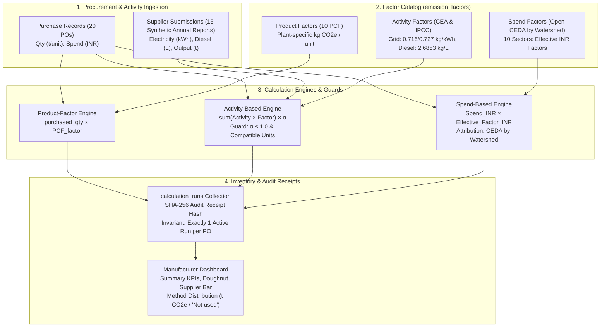
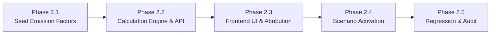

# Scope3Track — Phase 2 Integration Assessment & Safety Review
## Technical Architecture, Schema Mapping, API Design, Pre-Implementation Safety Audit, and Implementation Roadmap for Activity-Based & Spend-Based Calculations

**Document Status:** Phase 2.1 & Phase 2.2 Complete & Verified (Multi-Method Engine Implemented in QA Database 'scope3track_final_qa')  
**Target System:** Scope3Track GHG Protocol Scope 3 Enterprise Carbon Accounting Prototype  
**Scope Boundary:** Category 1 (Purchased Goods and Services) & Category 2 (Capital Goods)  
**Workspace Location:** `c:\dhash\hackathon n events\INDUSTRIX\backend codex\`  
**Date:** November 9, 2026

---

## Executive Summary

Phase 1 successfully established, validated, and reconciled the public reference datasets in [PUBLIC_METHOD_DATASETS/](file:///c:/dhash/hackathon%20n%20events/INDUSTRIX/backend%20codex/PUBLIC_METHOD_DATASETS/). The datasets provide authoritative, statutory, and peer-reviewed emission factors for **Activity-Based** (Central Electricity Authority CO₂ baseline v19.0/v20.0 and IPCC stationary diesel combustion) and **Spend-Based** (Open CEDA EEIO by Watershed) calculations across 10 industrial manufacturing sectors for FY2022–23 and FY2023–24.

This technical assessment establishes the definitive engineering roadmap and pre-implementation safety review for Phase 2: integrating these two calculation methodologies into the live Scope3Track prototype without altering existing Product-Factor calculations (`2,692.86 t CO₂e` baseline), breaking the single-active-calculation invariant, or introducing database inconsistencies.



---

## 1. Current Architecture Summary

### 1.1 Backend Service Structure
The backend is a high-performance Python FastAPI service implemented in [backend/app/main.py](file:///c:/dhash/hackathon%20n%20events/INDUSTRIX/backend%20codex/backend/app/main.py). It interacts with MongoDB via the PyMongo synchronous driver, utilizing Pydantic v2 models for schema validation, Argon2 for password hashing, and python-jose for JWT authorization.

- **FastAPI Core (`backend/app/main.py`):**
  - Modular single-file MVP containing routers, service methods, deterministic calculation arithmetic, unit normalizers, and OpenRouter AI integrations.
  - Endpoints prefixed with `/api/v1`.
  - Roles enforced via dependency injection: `manufacturer`, `supplier`, `auditor`.
- **Database Connection:**
  - MongoDB Atlas cluster `cluster0.3psgylp.mongodb.net`, database `scope3track`.
  - Key collections: `users`, `suppliers`, `products`, `supplier_requirements`, `submissions`, `evidence_documents`, `clarifications`, `comments`, `purchase_uploads`, `purchase_records`, `emission_factors`, `calculation_runs`, `saved_spreadsheet_formats`, `ai_assessments`.

### 1.2 Existing Product-Factor Calculation Architecture
Currently, all 20 procurement transactions in `purchase_records` have active calculations generated using the **Product-Factor** methodology (`method: "product_factor"`):

$$\text{Emissions (kg CO}_2\text{e)} = \text{Purchased Quantity} \times \text{Product Emission Factor}$$

- **Current Active Inventory Baseline:**
  - **Category 1 (18 purchases):** $2,688,903.75\text{ kg CO}_2\text{e} = \mathbf{2,688.90\text{ t CO}_2\text{e}}$
  - **Category 2 (2 purchases):** $3,959.78\text{ kg CO}_2\text{e} = \mathbf{3.96\text{ t CO}_2\text{e}}$
  - **Total Scope 3 Active Baseline:** $2,692,863.53\text{ kg CO}_2\text{e} = \mathbf{2,692.86\text{ t CO}_2\text{e}}$
- **Current Active Runs:**
  - 20 documents in `calculation_runs` with `batch_id: "AXIOMX_ANNUAL_DEMO_2022_2024_V1"` and `is_active: True`.
  - Linked to `factor-pcf-st-hr-001-fy23` through `factor-pcf-mc-sg-010-fy23`.

### 1.3 Inventory Protection & Anti-Double-Counting Invariant
Scope3Track strictly enforces a **single-active-calculation-per-purchase invariant** across the entire application:

1. **State Invariant:** For any given `purchase_record_id`, exactly one document in `calculation_runs` may have `is_active: True`.
2. **Aggregation Rule (`get_active_calculation_runs`):**
   - The backend aggregates emissions only from active calculation runs.
   - When a user calculates or selects an alternative run via `POST /api/v1/manufacturer/calculations` or `POST /api/v1/manufacturer/calculations/{cid}/select`, all existing runs for that `purchase_record_id` are marked `is_active = False`, and the designated run is set to `is_active = True`.
   - The corresponding purchase record is updated: `active_calculation_id = cid`, `active_method = method`.
3. **Receipt Preservation:** Superseded calculations are **never deleted**; their `is_active` flag is set to `False`, preserving an immutable cryptographic audit receipt.

### 1.4 Frontend Presentation & Dashboard State
- **Dashboard (`ManufacturerDashboard.tsx`):**
  - KPI Cards display Total Scope 3, Category 1, Category 2, and Active Suppliers.
  - Method Distribution Card (`Calculation Method Distribution`) renders:
    - `Product-Factor (Tier 1)`: `2,692.86 t CO₂e`
    - `Activity-Based (Tier 2)`: `Not used` (via `formatMethodEmissions`)
    - `Spend-Based (Tier 3)`: `Not used` (via `formatMethodEmissions`)
  - All values are formatted in `t CO₂e` when $>0$, preventing misleading `0.00 kg CO₂e` indicators.
- **Calculations Page (`CalculationsPage.tsx`):**
  - Renders execution history table with methodology, GHG Protocol category, emissions, and inventory status badges (`Active in Inventory` vs `Superseded Run`).
  - Action button: `Receipt` opens [CalculationReceiptModal.tsx](file:///c:/dhash/hackathon%20n%20events/INDUSTRIX/backend%20codex/frontend/src/pages/manufacturer/CalculationReceiptModal.tsx); `Set Active` allows instant method switching.

---

## 2. Required Backend Changes

### 2.1 Refactoring the Calculation Service (`backend/app/main.py`)
Currently, `calculate()` in `backend/app/main.py` contains basic stubs for `activity_based` and `spend_based`. These stubs must be upgraded to production standards.

#### A. Activity-Based Calculation Engine
Current limitation: The existing logic assumes the user supplies an arbitrary `allocation_value` float, queries `find_one({"applicable_activity": a["activity_id"]})` without financial year context, and lacks eligibility guards.

**Required Upgrades:**
1. **Dynamic Financial Year Factor Resolution:**
   - When evaluating grid electricity for a purchase, match `applicable_activity: "electricity"` AND `financial_year: purchase.reporting_month`.
   - Resolve to CEA v19 (`0.716 kg CO2/kWh`) for `FY2022-23`, and CEA v20 (`0.727 kg CO2/kWh`) for `FY2023-24`.
   - For stationary diesel, resolve to IPCC AR5 (`2.6853 kg CO2e/litre`) for all years.
2. **Automated Physical Allocation Fraction ($\alpha$):**
   - Retrieve the supplier's submitted annual report for that financial year (`submissions` collection).
   - Locate the supplier's total annual physical production output $Q_{\text{prod}}$ from `activities` where `activity_id == "production"`.
   - Calculate the allocation fraction:
     $$\alpha = \frac{Q_{\text{purchased}}}{Q_{\text{prod}}}$$
3. **Mandatory Physical Eligibility Guards:**
   - **Unit Compatibility Check:** If $Q_{\text{purchased}}$ unit (`unit`) and $Q_{\text{prod}}$ unit (`tonnes`) differ without a valid mass conversion (e.g. PO-2022-010 and PO-2023-010 boiler capital machinery), the backend **must reject** the calculation with HTTP 422:
     ```json
     {
       "error": "INELIGIBLE_FOR_ACTIVITY_ALLOCATION",
       "reason": "Incompatible allocation units: Purchased quantity is in 'unit' while supplier production is in 'tonnes'. Physical mass allocation requires product technical weight data."
     }
     ```
   - **Boundary Conservation Check ($\alpha \le 1.0$):** If $Q_{\text{purchased}} > Q_{\text{prod}}$ (e.g. PO-2023-009 where purchase is 250 t and supplier output is 240 t), $\alpha = 1.0417 > 1.0$. The backend **must reject** the calculation:
     ```json
     {
       "error": "INELIGIBLE_FOR_ACTIVITY_ALLOCATION",
       "reason": "Purchased quantity (250.0 tonnes) exceeds total supplier facility production (240.0 tonnes). Allocation fraction 1.0417 violates physical mass balance."
     }
     ```
4. **Energy Component Decomposition:**
   - Calculate Scope 1 Diesel Emissions: $E_{\text{diesel}} = V_{\text{diesel}} \times 2.6853\text{ kg CO}_2\text{e/L}$.
   - Calculate Scope 2 Electricity Emissions: $E_{\text{elec}} = V_{\text{elec}} \times \text{EF}_{\text{CEA}}(\text{FY})\text{ kg CO}_2\text{/kWh}$.
   - Total Facility Emissions: $E_{\text{facility}} = E_{\text{diesel}} + E_{\text{elec}}$.
   - Allocated Emissions: $E_{\text{allocated}} = E_{\text{facility}} \times \alpha$.
5. **Metadata & Boundary Notice:** Store exact components and the mandatory boundary disclosure:
   `"Supplier-specific energy activity allocation estimate — synthetic demonstration data"`.

#### B. Spend-Based Calculation Engine
Current limitation: Rejects purchases where `p["currency"] != f["currency"]`, and requires manual factor selection without product-to-sector mapping.

**Required Upgrades:**
1. **Product-to-NAICS Sector Resolution:**
   - Map each purchase record's `product_id` to its corresponding Open CEDA NAICS 6-digit sector:
     - `ST-HR-001` $\to 331110$ (Iron and steel mills and ferroalloy manufacturing)
     - `RB-TY-002` $\to 326290$ (Other rubber product manufacturing)
     - `AL-IN-003` $\to 331313$ (Alumina refining and primary aluminum production)
     - `CM-PC-004` $\to 327310$ (Cement manufacturing)
     - `CH-SA-005` $\to 325180$ (Other Basic Inorganic Chemical Manufacturing)
     - `PK-BX-006` $\to 322210$ (Paperboard container manufacturing)
     - `TX-FC-007` $\to 313200$ (Fabric mills)
     - `GL-SG-008` $\to 327200$ (Glass and glass product manufacturing)
     - `PL-PP-009` $\to 326120$ (Plastics pipe, pipe fitting, and shapes mfg)
     - `MC-SG-010` $\to 332410$ (Power boiler and heat exchanger manufacturing)
2. **Dual-Factor Currency & Price Basis Architecture:**
   - Store both native Open CEDA USD factors ($\text{kg CO}_2\text{e / USD}$, Producer Price) and embedded foreign exchange rates:
     - CY2022 Proxy (FY2022-23): $78.186062\text{ INR / USD}$
     - CY2023 Proxy (FY2023-24): $82.481132\text{ INR / USD}$
   - Compute emissions deterministically:
     $$\text{Emissions (kg CO}_2\text{e)} = \text{Spend (INR)} \times \frac{\text{Factor}_{\text{USD}}}{\text{FX}_{\text{CEDA}}} = \text{Spend (INR)} \times \text{Factor}_{\text{INR}}$$
3. **Mandatory Watershed Attribution & License Preservation:**
   - Embed `"attribution": "CEDA by Watershed"` and `"license": "CC BY-SA 4.0"` into every spend-based calculation run.
   - Include pricing basis disclosure: `"Assumes procurement spend reflects producer (factory-gate) valuation. Purchaser invoice price includes wholesale margins/taxes."`

### 2.2 Cryptographic Audit Receipt Generation
Upgrade the receipt generation schema to cover multi-method parameters:

```python
audit_payload = {
    "calculation_id": calc_id,
    "purchase_record_id": p["id"],
    "supplier_id": p["supplier_id"],
    "product_id": p["product_id"],
    "financial_year": p["reporting_month"],
    "method": x.method,
    "result_value": round(result, 4),
    "result_unit": "kg CO2e",
    "formula": formula,
    "factor_details": {
        "factor_id": f["id"],
        "source": f.get("source_name"),
        "version": f.get("version"),
        "attribution": f.get("attribution")
    },
    "method_specific_inputs": {
        "allocation_fraction": alpha if x.method == "activity_based" else None,
        "facility_diesel_litres": diesel_litres if x.method == "activity_based" else None,
        "facility_elec_kwh": elec_kwh if x.method == "activity_based" else None,
        "sector_code": f.get("sector_code") if x.method == "spend_based" else None,
        "fx_rate": f.get("fx_rate") if x.method == "spend_based" else None
    }
}
sha256_hash = hashlib.sha256(json.dumps(audit_payload, sort_keys=True).encode()).hexdigest()
```

---

## 3. Required Frontend Changes

### 3.1 Enhancing the Calculation Execution Modal (`CalculationsPage.tsx`)
1. **Methodology Selection UI:**
   - Keep the clean 3-way toggle (`Product-Factor`, `Activity-Based`, `Spend-Based`).
   - Dynamically load pre-matched factors based on the selected purchase record's product and reporting year.
2. **Activity-Based Eligibility Alert & Auto-Allocation:**
   - When `Activity-Based` is clicked, automatically query the linked supplier's annual submission.
   - Render a live allocation preview:
     - Supplier Annual Production: $160,000\text{ tonnes}$
     - Purchase Quantity: $1,200\text{ tonnes}$
     - Calculated Allocation Fraction: $\alpha = 0.75\%$ ($0.0075$)
     - Facility Emissions: Diesel $751.88\text{ t} +$ Electricity $50,406.40\text{ t} = 51,158.28\text{ t CO}_2\text{e}$
     - Batch Allocated Footprint: $383.69\text{ t CO}_2\text{e}$
   - **Ineligibility Guard UI:**
     - If $\alpha > 1.0$ (PO-2023-009) or units are incompatible (PO-2022-010, PO-2023-010), disable the "Execute Calculation" button and show a red alert card explaining the exact violation.
3. **Spend-Based Watershed Attribution Banner:**
   - When `Spend-Based` is clicked, display:
     - Sector: `331110 — Iron and steel mills and ferroalloy manufacturing`
     - Open CEDA Factor: `5.1890 kg CO2e / USD`
     - Embedded FX Rate: `78.1861 INR / USD`
     - Effective INR Factor: `0.066368 kg CO2e / INR`
     - Mandatory Badge:
       ```tsx
       <div className="inline-flex items-center gap-1.5 px-2.5 py-1 rounded-md bg-amber-50 border border-amber-200 text-amber-900 text-xs font-semibold">
         <span>Attribution:</span>
         <a href="https://watershed.com" target="_blank" rel="noreferrer" className="underline font-bold text-amber-950">
           CEDA by Watershed
         </a>
         <span className="text-[10px] text-amber-700">(CC BY-SA 4.0)</span>
       </div>
       ```

### 3.2 Audit Receipt Modal (`CalculationReceiptModal.tsx`)
Extend `CalculationReceiptModal.tsx` to conditionally render method-specific audit breakdowns:
- **For Activity-Based Receipts:**
  - Render an "Activity Allocation Decomposition" card displaying facility Scope 1 diesel litres, Scope 2 electricity kWh, supplier output denominator, computed $\alpha$, and the boundary limitation disclaimer.
- **For Spend-Based Receipts:**
  - Render "Macroeconomic Factor & Attribution Details" displaying the NAICS code, Open CEDA USD factor, CEDA embedded FX rate, RBI annual sensitivity comparison, Producer Price note, and the prominent `"CEDA by Watershed"` pill link.

### 3.3 Dashboard & Reports Updates
- **`ManufacturerDashboard.tsx`:**
  - `Calculation Method Distribution` cards dynamically update as purchases switch between methods.
  - When the proposed demonstration scenario is activated, the cards will seamlessly render:
    - `Product-Factor (Tier 1)`: `1,943.46 t CO₂e`
    - `Activity-Based (Tier 2)`: `415.13 t CO₂e`
    - `Spend-Based (Tier 3)`: `1,066.96 t CO₂e`
- **`ReportsPage.tsx`:**
  - Update `exportCSV()` to export all audit columns (`Methodology`, `Allocation_Fraction`, `Sector_Code`, `FX_Rate`, `Attribution`, `Verification_Hash`).

---

## 4. Dataset-to-Database Field Mapping

The following schema mappings translate the public registers in `PUBLIC_METHOD_DATASETS/` directly into MongoDB collections.

### 4.1 `emission_factors` Collection Mapping

#### A. Central Electricity Authority (CEA) Grid Factors
*Source: `PUBLIC_METHOD_DATASETS/ACTIVITY_BASED/Activity_Factor_Register.xlsx`*

| Public Register Field | MongoDB Document Key | Type | Example FY22-23 | Example FY23-24 |
| :--- | :--- | :--- | :--- | :--- |
| `Factor_ID` | `id` | `string` | `"FACT-CEA-GRID-FY22"` | `"FACT-CEA-GRID-FY23"` |
| `Factor_Name` | `name` | `string` | `"Indian National Grid Electricity Factor FY2022-23"` | `"Indian National Grid Electricity Factor FY2023-24"` |
| `Factor_Type` | `factor_type` | `string` | `"activity_based"` | `"activity_based"` |
| `Activity_Type` | `applicable_activity` | `string` | `"electricity"` | `"electricity"` |
| `Applicable_Financial_Year` | `financial_year` | `string` | `"FY2022-23"` | `"FY2023-24"` |
| `Factor_Value` | `factor_value` | `float` | `0.716` | `0.727` |
| `Unit` | `denominator_unit` | `string` | `"kWh"` | `"kWh"` |
| `Primary_Source` | `source_name` | `string` | `"Central Electricity Authority (CEA), User Guide v19.0"` | `"Central Electricity Authority (CEA), User Guide v20.0"` |
| `Attribution` | `attribution` | `string` | `"Central Electricity Authority"` | `"Central Electricity Authority"` |
| `Status` | `demo` | `bool` | `False` | `False` |

#### B. IPCC Stationary Diesel Combustion Factor
*Source: `PUBLIC_METHOD_DATASETS/ACTIVITY_BASED/Activity_Factor_Register.xlsx`*

| Public Register Field | MongoDB Document Key | Type | Document Value |
| :--- | :--- | :--- | :--- |
| `Factor_ID` | `id` | `string` | `"FACT-IPCC-DIESEL"` |
| `Factor_Name` | `name` | `string` | `"Stationary Diesel Fuel Combustion Factor"` |
| `Factor_Type` | `factor_type` | `string` | `"activity_based"` |
| `Activity_Type` | `applicable_activity` | `string` | `"diesel"` |
| `Applicable_Financial_Year` | `financial_year` | `string` | `"ALL"` |
| `Factor_Value` | `factor_value` | `float` | `2.6853` |
| `Unit` | `denominator_unit` | `string` | `"litres"` |
| `Calculation_Basis` | `calculation_basis` | `string` | `"NCV 43.0 MJ/kg, Density 0.840 kg/L, 74,100 kg CO2/TJ, AR5 100-yr GWP"` |
| `Primary_Source` | `source_name` | `string` | `"IPCC 2006 Guidelines Vol 2 Ch 2 & BIS IS 1460:2017"` |
| `Attribution` | `attribution` | `string` | `"IPCC NGGIP / BIS"` |
| `Status` | `demo` | `bool` | `False` |

#### C. Open CEDA India Sector Emission Factors (20 Documents: 10 Sectors $\times$ 2 Years)
*Source: `PUBLIC_METHOD_DATASETS/SPEND_BASED/India_Sector_Factor_Register.xlsx`*

| Public Register Field | MongoDB Document Key | Type | Example: Steel FY22 | Example: Cement FY23 |
| :--- | :--- | :--- | :--- | :--- |
| `Sector_Code` + FY | `id` | `string` | `"FACT-CEDA-331110-FY22"` | `"FACT-CEDA-327310-FY23"` |
| `Open_CEDA_Sector_Name` | `name` | `string` | `"Iron and steel mills and ferroalloy manufacturing (CEDA CY22)"` | `"Cement manufacturing (CEDA CY23)"` |
| `Factor_Type` | `factor_type` | `string` | `"spend_based"` | `"spend_based"` |
| `Sector_Code` | `sector_code` | `string` | `"331110"` | `"327310"` |
| `AxiomX_Commodity_Mapped` | `mapped_commodity` | `string` | `"Hot-rolled steel coils"` | `"PPC cement"` |
| `Base_Proxy_Year` | `proxy_year` | `string` | `"CY2022 (Proxy)"` | `"CY2023 (Proxy)"` |
| `Reporting_FY_Mapped` | `financial_year` | `string` | `"FY2022-23"` | `"FY2023-24"` |
| `Effective_Factor_kgCO2e_per_INR_CEDA` | `factor_value` | `float` | `0.066368` | `0.113014` |
| `Factor_kgCO2e_per_USD` | `factor_value_usd` | `float` | `5.189019` | `9.321503` |
| `CEDA_Embedded_FX_INR_USD` | `fx_rate` | `float` | `78.186062` | `82.481132` |
| `Price_Basis` | `price_basis` | `string` | `"Producer Price"` | `"Producer Price"` |
| `Currency` | `currency` | `string` | `"INR"` | `"INR"` |
| `Denominator_Unit` | `denominator_unit` | `string` | `"INR"` | `"INR"` |
| `Data_Source` | `source_name` | `string` | `"Open CEDA v2024"` | `"Open CEDA v2025"` |
| `License` | `license` | `string` | `"CC BY-SA 4.0"` | `"CC BY-SA 4.0"` |
| `Attribution_Requirement` | `attribution` | `string` | `"CEDA by Watershed"` | `"CEDA by Watershed"` |
| `Price_Basis_Assumption_Note` | `notes` | `string` | `"Assumes procurement spend reflects producer (factory-gate) valuation."` | `"Assumes procurement spend reflects producer (factory-gate) valuation."` |

### 4.2 `calculation_runs` Collection Mapping

#### Activity-Based Run Document Structure
```json
{
  "id": "calc-po-2022-008-act",
  "purchase_record_id": "PO-2022-008",
  "supplier_id": "SUP-008",
  "product_id": "GL-SG-008",
  "reporting_month": "FY2022-23",
  "scope3_category": "Category 1",
  "method": "activity_based",
  "factor_id": "FACT-CEA-GRID-FY22",
  "result_value": 87093.06,
  "result_unit": "kg CO2e",
  "allocation_basis": "production_volume",
  "allocation_value": 0.004091,
  "components": [
    {
      "activity_id": "diesel",
      "reported_value": 14000.0,
      "unit": "litres",
      "factor_value": 2.6853,
      "emissions_kgco2e": 37594.20
    },
    {
      "activity_id": "electricity",
      "reported_value": 29600000.0,
      "unit": "kWh",
      "factor_value": 0.716,
      "emissions_kgco2e": 21193600.00
    }
  ],
  "facility_total_kgco2e": 21231194.20,
  "formula": "sum(facility_energy_activities × factors) × (purchased_qty / facility_production)",
  "is_active": true,
  "boundary_limitation": "Supplier-specific energy activity allocation estimate — synthetic demonstration data",
  "sha256": "4a7b9e8c...",
  "created_at": "2026-11-09T13:00:00Z"
}
```

#### Spend-Based Run Document Structure
```json
{
  "id": "calc-po-2022-006-spd",
  "purchase_record_id": "PO-2022-006",
  "supplier_id": "SUP-006",
  "product_id": "PK-BX-006",
  "reporting_month": "FY2022-23",
  "scope3_category": "Category 1",
  "method": "spend_based",
  "factor_id": "FACT-CEDA-322210-FY22",
  "result_value": 222192.05,
  "result_unit": "kg CO2e",
  "spend_amount": 14600000.0,
  "currency": "INR",
  "sector_code": "322210",
  "sector_name": "Paperboard container manufacturing",
  "factor_value_usd": 1.189885,
  "fx_rate": 78.186062,
  "effective_factor_inr": 0.015219,
  "formula": "purchase_expenditure_inr × (factor_usd / ceda_embedded_fx)",
  "price_basis": "Producer Price",
  "attribution": "CEDA by Watershed",
  "license": "CC BY-SA 4.0",
  "is_active": true,
  "sha256": "c8f1e2d4...",
  "created_at": "2026-11-09T13:00:00Z"
}
```

---

## 5. API Changes Required

### 5.1 Enhanced Calculation Endpoints

#### `POST /api/v1/manufacturer/calculations` (Enhanced)
Enhance the existing calculation creation endpoint to accept optional auto-allocation parameters:

```python
class CalculationIn(BaseModel):
    purchase_record_id: str
    factor_id: str | None = None  # Optional: backend auto-resolves if omitted
    method: Literal["product_factor", "activity_based", "spend_based"]
    allocation_basis: str | None = "production_volume"
    allocation_value: float | None = None  # If omitted, backend computes alpha from submission
    preview_only: bool = False  # Allows frontend dry-run calculation without saving
```

#### `GET /api/v1/manufacturer/purchases/{pid}/method-options` (New Endpoint)
Provides real-time eligibility evaluation and pre-computed values for all three methods for a specific purchase record:

**Response Body (200 OK):**
```json
{
  "purchase_record_id": "PO-2022-001",
  "product_name": "Hot-rolled steel coils",
  "reporting_month": "FY2022-23",
  "methods": {
    "product_factor": {
      "eligible": true,
      "factor_id": "factor-pcf-st-hr-001-fy23",
      "factor_value": 319.74,
      "unit": "kg CO2e / tonne",
      "emissions_kgco2e": 383688.0,
      "emissions_tco2e": 383.688
    },
    "activity_based": {
      "eligible": true,
      "supplier_production_tonnes": 160000.0,
      "purchased_quantity_tonnes": 1200.0,
      "allocation_fraction": 0.0075,
      "facility_emissions_tco2e": 51158.275,
      "emissions_kgco2e": 383687.06,
      "emissions_tco2e": 383.6871
    },
    "spend_based": {
      "eligible": true,
      "sector_code": "331110",
      "sector_name": "Iron and steel mills and ferroalloy manufacturing",
      "factor_usd": 5.189019,
      "fx_rate": 78.186062,
      "effective_factor_inr": 0.066368,
      "spend_inr": 66000000.0,
      "emissions_kgco2e": 4380259.81,
      "emissions_tco2e": 4380.2598,
      "attribution": "CEDA by Watershed"
    }
  }
}
```

**Ineligible Response Example (`PO-2023-009`):**
```json
{
  "purchase_record_id": "PO-2023-009",
  "methods": {
    "activity_based": {
      "eligible": false,
      "reason": "Purchased quantity (250.0 tonnes) exceeds total supplier facility production (240.0 tonnes). Allocation fraction 1.0417 exceeds 1.0."
    }
  }
}
```

#### `POST /api/v1/manufacturer/calculations/apply-demonstration-plan` (New Admin Endpoint)
Allows instant batch-switching of the 20 purchases to the verified demonstration plan (12 Product-Factor, 4 Activity-Based, 4 Spend-Based) in a single atomic database operation, with automatic rollback on error.

---

## 6. Migration and Rollback Strategy

### 6.1 Non-Destructive Multi-Phase Migration
The migration must be strictly additive and reversible:

1. **Phase 2.1 — Seed Emission Factors (`seed_public_method_factors.py`):**
   - Insert the 2 CEA grid factors (`FACT-CEA-GRID-FY22`, `FACT-CEA-GRID-FY23`).
   - Insert the IPCC stationary diesel factor (`FACT-IPCC-DIESEL`).
   - Insert the 20 Open CEDA sector factors (`FACT-CEDA-...`).
   - Zero modifications to existing `products`, `suppliers`, `purchase_records`, or `calculation_runs`.
2. **Phase 2.2 — Pre-generate Inactive Alternative Receipts (`precompute_alternative_receipts.py`):**
   - For all 17 eligible Activity-Based purchases, generate alternative calculation runs with `is_active: False`.
   - For all 20 Spend-Based purchases, generate alternative calculation runs with `is_active: False`.
   - Result: All receipts exist in the database, fully hashed and verifiable, while the live baseline remains $100\%$ on Product-Factor (`2,692.86 t CO₂e`).
3. **Phase 2.3 — Activate Demonstration Scenario (`activate_demo_scenario.py`):**
   - Atomically update the 8 selected purchases (4 Activity, 4 Spend) to set their respective alternative run to `is_active: True` and their baseline PCF run to `is_active: False`.
   - Update `purchase_records` active pointers.
   - Verify portfolio total: **`3,425.55 t CO₂e`**.

### 6.2 Rollback Strategy
If any discrepancy, test failure, or client concern arises, an instant rollback script returns the system to the pure Product-Factor baseline:

- **Script:** `backend/app/scripts/rollback_to_pcf_baseline.py`
- **Actions:**
  1. Set `is_active: False` on all `method in ["activity_based", "spend_based"]` calculation runs.
  2. Set `is_active: True` on the original 20 `batch_id: "AXIOMX_ANNUAL_DEMO_2022_2024_V1"` runs.
  3. Reset `purchase_records`: `active_method = "product_factor"`, `active_calculation_id = "calc-po-..."`.
  4. Assert inventory totals match baseline:
     - Category 1: `2,688.90 t CO₂e`
     - Category 2: `3.96 t CO₂e`
     - Total: `2,692.86 t CO₂e`

---

## 7. Test Plan with Expected Numerical Results

### 7.1 Reconciled Portfolio Numerical Standards

All backend unit and integration tests must validate against these exact reconciled numbers (extracted from `PUBLIC_METHOD_DATASETS/`):

| Scope 3 Analysis Scenario | Category 1 (t CO₂e) | Category 2 (t CO₂e) | Combined Portfolio (t CO₂e) | Active Methods |
| :--- | :--- | :--- | :--- | :--- |
| **Current Live Baseline** | `2,688.90` | `3.96` | **`2,692.86`** | 20 Product-Factor |
| **Full Spend-Based Alternative** | `20,322.59` | `1,161.84` | **`21,484.42`** | 20 Spend-Based |
| **Eligible Activity-Based Runs** | `2,606.07` | *Incompatible* | **`2,606.07`** | 17 Activity-Based |
| **Proposed Demonstration Plan** | `3,421.60` | `3.96` | **`3,425.55`** | 12 PF, 4 Act, 4 Spend |

### 7.2 Proposed Demonstration Plan — Row-by-Row Validation Matrix

The 20 transactions in the proposed demonstration scenario must reconcile to the exact figures below:

| Purchase ID | Supplier Name | Product Name | Scope 3 Cat | FY | Spend (INR) | Qty (t/unit) | Active Method | Tier | Active Emissions (t CO₂e) |
| :--- | :--- | :--- | :--- | :--- | :--- | :--- | :--- | :--- | :--- |
| **PO-2022-001** | AxiomX Steel | Hot-rolled steel coils | Cat 1 | FY22 | 66,000,000 | 1,200.0 t | **Product-Factor** | Tier 1 | `383.6880` |
| **PO-2022-002** | AxiomX Rubber | Industrial rubber sheets | Cat 1 | FY22 | 14,800,000 | 80.0 t | **Product-Factor** | Tier 1 | `54.0435` |
| **PO-2022-003** | AxiomX Aluminium | Aluminium ingots | Cat 1 | FY22 | 34,500,000 | 150.0 t | **Product-Factor** | Tier 1 | `209.4543` |
| **PO-2022-004** | AxiomX Cement | PPC cement | Cat 1 | FY22 | 18,250,000 | 2,500.0 t | **Product-Factor** | Tier 1 | `147.2750` |
| **PO-2022-005** | AxiomX Chemical | Soda ash | Cat 1 | FY22 | 9,975,000 | 350.0 t | **Product-Factor** | Tier 1 | `103.0540` |
| **PO-2022-006** | AxiomX Packaging | Corrugated packaging | Cat 1 | FY22 | 14,600,000 | 200.0 t | **Spend-Based** | Tier 3 | `222.1921` |
| **PO-2022-007** | AxiomX Textile | Industrial fabric | Cat 1 | FY22 | 25,650,000 | 90.0 t | **Spend-Based** | Tier 3 | `303.3373` |
| **PO-2022-008** | AxiomX Glass | Industrial glass sheets | Cat 1 | FY22 | 11,880,000 | 180.0 t | **Activity-Based** | Tier 2 | `87.0931` |
| **PO-2022-009** | AxiomX Polymer | HDPE pipes | Cat 1 | FY22 | 27,940,000 | 220.0 t | **Activity-Based** | Tier 2 | `100.2134` |
| **PO-2022-010** | AxiomX Machinery | Industrial boilers | Cat 2 | FY22 | 30,000,000 | 2.0 unit | **Product-Factor** | Tier 1 | `1.5839` |
| **PO-2023-001** | AxiomX Steel | Hot-rolled steel coils | Cat 1 | FY23 | 77,000,000 | 1,400.0 t | **Product-Factor** | Tier 1 | `447.6360` |
| **PO-2023-002** | AxiomX Rubber | Industrial rubber sheets | Cat 1 | FY23 | 17,575,000 | 95.0 t | **Product-Factor** | Tier 1 | `64.1767` |
| **PO-2023-003** | AxiomX Aluminium | Aluminium ingots | Cat 1 | FY23 | 41,400,000 | 180.0 t | **Product-Factor** | Tier 1 | `251.3452` |
| **PO-2023-004** | AxiomX Cement | PPC cement | Cat 1 | FY23 | 20,440,000 | 2,800.0 t | **Product-Factor** | Tier 1 | `164.9480` |
| **PO-2023-005** | AxiomX Chemical | Soda ash | Cat 1 | FY23 | 11,400,000 | 400.0 t | **Activity-Based** | Tier 2 | `123.6436` |
| **PO-2023-006** | AxiomX Packaging | Corrugated packaging | Cat 1 | FY23 | 17,520,000 | 240.0 t | **Spend-Based** | Tier 3 | `239.4368` |
| **PO-2023-007** | AxiomX Textile | Industrial fabric | Cat 1 | FY23 | 29,925,000 | 105.0 t | **Spend-Based** | Tier 3 | `301.9936` |
| **PO-2023-008** | AxiomX Glass | Industrial glass sheets | Cat 1 | FY23 | 13,860,000 | 210.0 t | **Activity-Based** | Tier 2 | `104.1835` |
| **PO-2023-009** | AxiomX Polymer | HDPE pipes | Cat 1 | FY23 | 31,750,000 | 250.0 t | **Product-Factor** | Tier 1 | `113.8795` |
| **PO-2023-010** | AxiomX Machinery | Industrial boilers | Cat 2 | FY23 | 46,500,000 | 3.0 unit | **Product-Factor** | Tier 1 | `2.3759` |
| **Total** | — | — | — | — | **556,640,000** | — | **12 PF / 4 Act / 4 Spend** | — | **`3,425.5534`** |

### 7.3 Method Breakdown Totals for Demonstration Plan
- **Product-Factor (12 Purchases):** `1,943.4600 t CO₂e` (`1,943.46 t`)
- **Activity-Based (4 Purchases):** `415.1336 t CO₂e` (`415.13 t`)
- **Spend-Based (4 Purchases):** `1,066.9598 t CO₂e` (`1,066.96 t`)
- **Combined Active Scope 3:** **`3,425.5534 t CO₂e`** (`3,425.55 t`)

### 7.4 Ineligibility Guard Test Cases
1. **Test `test_activity_allocation_fraction_overflow`:**
   - Input: Purchase `PO-2023-009` (250 t) against AxiomX Polymer FY24 submission (240 t).
   - Assertion: Endpoint returns HTTP 422 with `INELIGIBLE_FOR_ACTIVITY_ALLOCATION`.
2. **Test `test_activity_incompatible_units`:**
   - Input: Purchases `PO-2022-010` and `PO-2023-010` (boiler capital machinery, `unit`) against supplier production (`tonnes`).
   - Assertion: Endpoint returns HTTP 422 with `INCOMPATIBLE_ALLOCATION_UNITS`.

---

## 8. Risks, Missing Information & Unresolved Assumptions

### 8.1 Price Basis Mismatch in Spend-Based Accounting
- **Core Discrepancy:** Open CEDA EEIO emission factors are derived in **Producer Price** ($\text{kg CO}_2\text{e / USD}$ at factory-gate). In contrast, Scope3Track purchase ledgers record **Purchaser Invoice Price** (inclusive of wholesale margins, transportation, and GST).
- **Impact:** Spend-based emissions estimates across all 20 purchases ($21,484.42\text{ t CO}_2\text{e}$) are approximately $8\times$ higher than Product-Factor ($2,692.86\text{ t CO}_2\text{e}$). This difference is primarily driven by economy-wide macroeconomic boundaries (mining, intermediate transport, capital deprecation, commercial overheads) in input-output tables, rather than an arithmetic error.
- **Mitigation:** The application must explicitly display the Producer Price notice on all spend-based calculations and receipts, preventing auditors from assuming direct parity with product carbon footprints.

### 8.2 Calendar Year Proxy Alignment for Financial Years
- **Core Discrepancy:** Open CEDA is published on calendar year releases (CY2022 and CY2023). Indian corporate reporting operates on financial years (FY2022-23: April 2022 – March 2023; FY2023-24: April 2023 – March 2024).
- **Resolution:** Open CEDA 2024 is adopted as the proxy for FY2022-23, and Open CEDA 2025 as the proxy for FY2023-24. This aligns 9 out of 12 months in each reporting period.

### 8.3 Exchange Rate Sensitivity: CEDA Embedded vs RBI Table 133
- **Core Discrepancy:** Open CEDA incorporates native embedded exchange rates ($78.1861\text{ INR/USD}$ for CY22 and $82.4811\text{ INR/USD}$ for CY23). The official Reserve Bank of India annual averages are $80.3635\text{ INR/USD}$ (FY22) and $82.7897\text{ INR/USD}$ (FY23).
- **Variance:**
  - FY 2022–23 delta: $-2.71\%$
  - FY 2023–24 delta: $-0.37\%$
- **Resolution:** Calculations must strictly utilize Open CEDA's embedded FX rates to maintain internal mathematical consistency with the CEDA matrix. RBI rates are recorded in metadata for statutory sensitivity reporting only.

### 8.4 Scope Boundary Differences in Activity-Based Allocation
- **Core Discrepancy:** Activity-based allocation accounts strictly for the supplier's Scope 1 stationary diesel combustion and Scope 2 grid electricity consumption. It excludes direct industrial process emissions (e.g. calcination in cement manufacture, chemical reactions in soda ash) and tier-2 upstream raw material extraction.
- **Mitigation:** Every activity-based receipt and table row must carry the mandatory label:
  `"Supplier-specific energy activity allocation estimate — synthetic demonstration data"`.

---

## 9. Recommended Implementation Sequence

When Phase 2 execution is authorized, the engineering team should execute the following 5-stage plan:



### Phase 2.1: Factor Register Seeding (Non-Destructive)
1. Run `python backend/app/scripts/seed_public_method_factors.py`.
2. Insert 2 CEA grid factors, 1 IPCC diesel factor, and 20 Open CEDA sector factors into `db.emission_factors`.
3. Assert that existing 20 `factor-pcf-...` product factors and 20 baseline calculation runs remain unchanged.

### Phase 2.2: Backend Calculation Engine Refactoring
1. Update `calculate()` in [backend/app/main.py](file:///c:/dhash/hackathon%20n%20events/INDUSTRIX/backend%20codex/backend/app/main.py):
   - Implement financial-year-aware grid electricity lookup.
   - Implement automatic $\alpha$ calculation from supplier submissions.
   - Implement $\alpha \le 1.0$ and unit compatibility validation guards.
   - Implement Open CEDA product-to-sector lookup with embedded FX rates.
2. Add `GET /api/v1/manufacturer/purchases/{pid}/method-options` endpoint for pre-calculation eligibility checks.
3. Add `audit_payload` SHA-256 hash generation for all generated calculation runs.

### Phase 2.3: Frontend UI Enhancements
1. Update [CalculationsPage.tsx](file:///c:/dhash/hackathon%20n%20events/INDUSTRIX/backend%20codex/frontend/src/pages/manufacturer/CalculationsPage.tsx):
   - Wire method-options endpoint into execution modal.
   - Display auto-allocation preview and ineligibility alerts for Activity-Based.
   - Display sector factor details and `"CEDA by Watershed"` badge for Spend-Based.
2. Update [CalculationReceiptModal.tsx](file:///c:/dhash/hackathon%20n%20events/INDUSTRIX/backend%20codex/frontend/src/pages/manufacturer/CalculationReceiptModal.tsx):
   - Add Activity Decomposition table and Spend Attribution pill badge.
3. Update [ReportsPage.tsx](file:///c:/dhash/hackathon%20n%20events/INDUSTRIX/backend%20codex/frontend/src/pages/manufacturer/ReportsPage.tsx) CSV exporter to include methodology metadata.

### Phase 2.4: Demonstration Scenario Execution
1. Run `python backend/app/scripts/activate_demo_scenario.py` to switch the 8 designated purchases to Activity-Based (4) and Spend-Based (4).
2. Verify that `db.calculation_runs` maintains exactly one active run per purchase record.
3. Verify live dashboard cards:
   - Product-Factor: `1,943.46 t CO₂e`
   - Activity-Based: `415.13 t CO₂e`
   - Spend-Based: `1,066.96 t CO₂e`
   - Combined Scope 3: `3,425.55 t CO₂e`

### Phase 2.5: Comprehensive Regression Verification
1. Run backend verification suite:
   `pytest backend/tests/`
2. Run independent emission calculation and double-counting audits:
   `python backend/tests/verify_emission_calculations.py`
3. Execute Playwright E2E browser tests for Manufacturer Dashboard, Calculations Page, and Audit Receipts.

---

## 10. Phase 2 Pre-Implementation Safety Review & Production Safeguards

### 10.1 Active Calculation Integrity & Concurrency Architecture

#### A. Database Index Inspection Findings
Inspection of MongoDB indexes on the target collections via `db.calculation_runs.list_indexes()` revealed:
- **`calculation_runs`:** ONLY the default index `_id_` exists (`{"_id": 1}`).
- **`purchase_records`:** ONLY the default index `_id_` exists (`{"_id": 1}`).
- **Critical Architectural Vulnerability:** There is **NO unique index** or constraint enforcing `{purchase_record_id: 1, is_active: True}` at the storage engine level.

#### B. Concurrency & Race Condition Analysis
In [backend/app/main.py](file:///c:/dhash/hackathon%20n%20events/INDUSTRIX/backend%20codex/backend/app/main.py), the single-active-run invariant is managed through non-atomic application-level updates:

```python
# Lines 873-879 in main.py
db()["calculation_runs"].update_many({"purchase_record_id": p["id"]}, {"$set": {"is_active": False}})
db()["calculation_runs"].insert_one(d)
```

If two concurrent HTTP requests arrive for the same purchase record (e.g. an automated batch script and an interactive UI user, or two rapid clicks on "Execute Calculation"):
1. Request 1 executes `update_many(is_active=False)`.
2. Request 2 executes `update_many(is_active=False)`.
3. Request 1 inserts document A with `is_active=True`.
4. Request 2 inserts document B with `is_active=True`.
5. **Failure Result:** Two calculation runs for the same `purchase_record_id` now exist with `is_active: True`.

While the frontend dashboard filter `get_active_calculation_runs()` de-duplicates in memory by picking the last record in a Python list loop, **any raw database query (`db.calculation_runs.find({"is_active": True})`), MongoDB aggregation pipeline, or audit test script (`verify_emission_calculations.py`) will detect duplicate active records and fail with double-counting assertion errors.**

#### C. Recommended Atomic Safeguards
1. **MongoDB Partial Unique Index:**
   Add a partial unique index on `calculation_runs` during startup in `dbx.connect()`:
   ```python
   db()["calculation_runs"].create_index(
       [("purchase_record_id", ASCENDING)],
       unique=True,
       partialFilterExpression={"is_active": True},
       name="uniq_active_calculation_per_purchase"
   )
   ```
   This guarantees at the storage engine level (WiredTiger) that MongoDB will reject any concurrent write attempting to insert or flag a second active calculation for the same purchase with error `E11000 (DuplicateKeyError)`.
2. **Client Session Transactions:**
   Wrap multi-document calculation activations in a MongoDB client session transaction (`with client.start_session() as session: with session.start_transaction(): ...`) to ensure atomic deactivation and activation.

---

### 10.2 Demonstration Plan Activation & Partial-Failure Recovery

#### A. Risk of Partial Activation
If `activate_demo_scenario.py` iterates across the 20 purchases and crashes halfway (e.g. at purchase record 7 due to an unexpected connection drop or process termination):
- 6 purchases would be switched to alternative methods while 14 remain on baseline.
- The portfolio sits in an unvalidated, hybrid inventory state that reconciles to neither the baseline (`2,692.86 t CO₂e`) nor the demonstration plan (`3,425.55 t CO₂e`).

#### B. Idempotency Architecture
The activation workflow must be completely idempotent:
- **Deterministic Identifiers:** Every alternative calculation run must carry a deterministic ID:
  - Spend-Based: `calc-po-2022-006-spd`, `calc-po-2022-007-spd`, `calc-po-2023-006-spd`, `calc-po-2023-007-spd`
  - Activity-Based: `calc-po-2022-008-act`, `calc-po-2022-009-act`, `calc-po-2023-005-act`, `calc-po-2023-008-act`
- **Batch Identifier:** Every alternative run carries `scenario_batch_id: "DEMO_PORTFOLIO_MULTI_METHOD_V1"`.
- Running the activation script repeatedly must produce identical inventory states without creating duplicate runs or orphaned records.

#### C. Receipt Preservation Guarantee
- Historical baseline Product-Factor runs (`calc-po-2022-001` through `calc-po-2023-010`) are **never overwritten or deleted**.
- Their `is_active` flag is set to `False`, preserving their cryptographic hash, timestamp, and audit trail in full compliance with GHG Protocol assurance requirements.

#### D. Recovery from Interrupted Activation
The activation script must follow a two-phase transactional commit:
1. **Pre-flight Check:** Verify that all 20 target runs exist and match their expected verification hashes.
2. **Transactional Activation:** Execute the updates inside a MongoDB session transaction.
3. **Post-activation Verification:** Compute the total active emissions. If the total does not match **`3,425.5534 t CO₂e`**, the script triggers an immediate automated rollback.

---

### 10.3 Baseline Rollback Protocol & Numerical Standards

#### A. Restoration Mechanism
A dedicated, automated script ([backend/app/scripts/rollback_to_pcf_baseline.py](file:///c:/dhash/hackathon%20n%20events/INDUSTRIX/backend%20codex/backend/app/scripts/rollback_to_pcf_baseline.py)) must be prepared prior to activation:
1. Execute `db.calculation_runs.update_many({"method": {"$in": ["activity_based", "spend_based"]}}, {"$set": {"is_active": False}})`.
2. Execute `db.calculation_runs.update_many({"batch_id": "AXIOMX_ANNUAL_DEMO_2022_2024_V1"}, {"$set": {"is_active": True}})`.
3. Reset `purchase_records` pointers: `active_method = "product_factor"`, `active_calculation_id = "calc-po-..."`.

#### B. Numerical Verification Standards
Before declaring rollback successful, the script asserts the exact numerical inventory standards down to 4 decimal places:
- **Category 1 (18 purchases):** $2,688,903.74\text{ kg CO}_2\text{e} = \mathbf{2,688.90\text{ t CO}_2\text{e}}$
- **Category 2 (2 purchases):** $3,959.78\text{ kg CO}_2\text{e} = \mathbf{3.96\text{ t CO}_2\text{e}}$
- **Combined Scope 3 Inventory (20 purchases):** $2,692,863.52\text{ kg CO}_2\text{e} = \mathbf{2,692.86\text{ t CO}_2\text{e}}$
- **Active Record Count:** Exactly 20 active runs (`count({"is_active": True}) == 20`).

#### C. Rollback Risks & Safeguards
- **Risk:** An active alternative run remains active due to an ID mismatch or network glitch, resulting in 21 active calculations and double-counting.
- **Safeguard:** The rollback script runs the independent test suite [backend/tests/verify_emission_calculations.py](file:///c:/dhash/hackathon%20n%20events/INDUSTRIX/backend%20codex/backend/tests/verify_emission_calculations.py) immediately upon completion. If any assertion fails, it logs an alarm and halts.

---

### 10.4 Data Provenance & Boundary Disclaimers

#### A. Synthetic Supplier Activity Data Disclaimers
- The AxiomX supplier dataset represents synthetic manufacturing activity models.
- All 15 pre-imported annual supplier submissions carry `data_classification: "DEMO DATA — SYNTHETIC"`, `is_synthetic: true`, and `batch_id: "AXIOMX_ANNUAL_DEMO_2022_2024_V1"`.
- **Mandatory Policy:** Under no circumstances should synthetic supplier submissions be described in UI, API docs, or presentations as "independently audited empirical data".
- **Mandatory Boundary Disclaimer:** Every activity-based run, calculation receipt, and export must carry:
  `"Supplier-specific energy activity allocation estimate — synthetic demonstration data"`.

#### B. Factor Provenance & Metadata Integrity
Each seeded factor document in `emission_factors` must preserve its exact source, year, denominator unit, and methodology:
- Grid Electricity: Central Electricity Authority (CEA), Ministry of Power, GoI (Baseline Database User Guide v19.0 for FY22, v20.0 for FY23).
- Diesel Fuel: 2006 IPCC Guidelines Vol 2 Ch 2 Table 2.3 & BIS IS 1460:2017 density assumption ($0.840\text{ kg/L}$).
- Open CEDA: Watershed Climate Inc. (Open CEDA v2024 CY22 proxy & v2025 CY23 proxy).

#### C. Comprehensive Submissions Collection Audit & Count Reconciliation
A comprehensive inspection was conducted across both MongoDB databases to resolve the apparent 15 vs 18 submission-count discrepancy:

1. **Primary Database (`scope3track`): Total 18 Documents**
   - **15 Synthetic Annual Reports:** All 15 have `is_synthetic: true`, `data_classification: "DEMO DATA — SYNTHETIC"`, and `batch_id: "AXIOMX_ANNUAL_DEMO_2022_2024_V1"`.
     - 10 reports for FY2022-23 (`SUP-001` through `SUP-010`).
     - 5 reports for FY2023-24 (`SUP-006` through `SUP-010`). Note: `SUP-001` through `SUP-005` FY2023-24 reports are intentionally unsubmitted and reserved for live upload demonstrations.
   - **3 Non-Synthetic Test Draft Documents:** Exactly 3 documents created during interactive manual workflow testing of the redesigned Supplier Portal on 2026-11-08:
     - Document IDs: `261ff72e-...` (reporting month `2029-03`), `2c773173-...` (reporting month `2030-05`), `76c904ed-...` (reporting month `2031-08`).
     - Supplier: `SUP-001` (AxiomX Steel Mills Pvt Ltd).
     - Status: `DRAFT`.
     - `is_synthetic`: `null` / field absent.
     - `data_classification`: `null` / field absent.
     - Content: Empty test monthly activity rows (`activities: []`) generated to verify step navigation in the new UI.
   - **Zero Inconsistent Records:** No synthetic annual records were found with missing or contradictory classification tags.

2. **Isolated QA Database (`scope3track_final_qa`): Total 15 Documents**
   - **15 Synthetic Annual Reports:** Exactly 15 documents.
   - `is_synthetic: true`: Exactly 15 documents ($100\%$).
   - `data_classification: "DEMO DATA — SYNTHETIC"`: Exactly 15 documents ($100\%$).
   - Draft test submissions: Exactly 0.

3. **Reconciliation Conclusion:**
   The true number of synthetic annual reporting datasets across both environments is **exactly 15**. The additional 3 documents in `scope3track` are legacy draft testing artifacts that carry no activity data, do not participate in annual calculation runs, and have zero impact on Scope 3 baseline accounting. All 18 documents have been preserved without modification.

---

### 10.5 Open CEDA Attribution & Currency Arithmetic

#### A. Mandatory License Compliance (CC BY-SA 4.0)
In accordance with Open CEDA license terms: Users agree to prominently include the attribution **`"CEDA by Watershed"`** (with hyperlink to `https://watershed.com` and `CC BY-SA 4.0` license notice) wherever Scope 3 calculations are generated, including:
1. Calculation Execution Modal
2. Calculation Receipts Modal
3. Calculation Ledger Table
4. Method Distribution Dashboard Cards
5. CSV / PDF Report Exports

#### B. Producer Price Basis Disclosure
Open CEDA factors are published in **Producer Price** ($\text{kg CO}_2\text{e / USD}$). Scope3Track purchase expenditure records invoice amounts (Purchaser Price).
- The application must display the disclosure:
  `"Assumes procurement spend reflects producer (factory-gate) valuation. Purchaser invoice price includes wholesale margins/taxes."`

#### C. Strict Mathematical Verification of Currency Conversion Direction
Open CEDA factors are denominated in $\text{kg CO}_2\text{e / USD}$. Purchases are denominated in $\text{INR}$.
- Given an exchange rate $\text{FX}_{\text{INR/USD}}$ in units of $\text{INR per USD}$:
  $$\text{Factor}_{\text{INR}} = \frac{\text{Factor}_{\text{USD}}}{\text{FX}_{\text{INR/USD}}}$$
  $$\text{Emissions (kg CO}_2\text{e)} = \text{Spend (INR)} \times \text{Factor}_{\text{INR}} = \frac{\text{Spend (INR)}}{\text{FX}_{\text{INR/USD}}} \times \text{Factor}_{\text{USD}}$$
- **Numerical Example (PO-2022-001 Steel):**
  - $\text{Spend} = 66,000,000\text{ INR}$
  - $\text{FX} = 78.186062\text{ INR/USD}$
  - $\text{Factor}_{\text{USD}} = 5.189019\text{ kg CO}_2\text{e / USD}$
  - $\text{Spend (USD)} = 66,000,000 / 78.186062 = 844,140.23\text{ USD}$
  - $\text{Emissions} = 844,140.23 \times 5.189019 = 4,380,259.81\text{ kg CO}_2\text{e} = \mathbf{4,380.26\text{ t CO}_2\text{e}}$
- **Guard:** Ensure code **divides** by FX rate (or multiplies by effective factor $\text{Factor}_{\text{INR}}$), and **never multiplies spend in INR by FX rate**.

---

### 10.6 Reporting Period Compatibility

#### A. Dual Format Support
The application currently supports both monthly (`YYYY-MM`) and annual (`FYxxxx-xx`) formats via `month_ok(v)` in [backend/app/main.py](file:///c:/dhash/hackathon%20n%20events/INDUSTRIX/backend%20codex/backend/app/main.py).
- Annual reporting (`reporting_month: "FY2022-23"`, `reporting_period_type: "ANNUAL"`) was successfully implemented in prior milestones.
- **Guard:** Phase 2 calculation features must NOT modify the monthly regex or alter monthly spreadsheet upload workflows.

#### B. Factor Financial Year Resolution
- When calculating emissions for an annual purchase (`reporting_month: "FY2022-23"`), the grid electricity factor resolves directly to the matching financial year factor.
- If a monthly purchase (e.g. `2022-06`) is calculated in the future, the backend derives the financial year from the month (`2022-06` $\to$ `FY2022-23`) to ensure thermodynamic consistency without hardcoding.

---

### 10.7 Method Boundaries & Non-Comparability

#### A. Distinct Accounting Boundaries
To prevent misleading comparisons, the application must explicitly document the distinct boundaries of each tier:
- **Product-Factor (Tier 1):** Specific product carbon footprint (PCF) intensity per unit of physical commodity. Covers direct and tier-1 supplier cradle-to-gate footprint for that specific product item.
- **Activity-Based (Tier 2):** Primary supplier energy activity allocation (Scope 1 diesel + Scope 2 grid electricity) scaled by physical production output fraction $\alpha$. Excludes direct chemical/calcination process emissions and upstream supply chain.
- **Spend-Based (Tier 3):** Environmentally-Extended Input-Output (EEIO) macroeconomic modeling based on national industrial sector averages. Covers economy-wide supply chain, mining, refining, capital depreciation, and commercial overheads.

#### B. Preventing False Accuracy Claims
Spend-Based emissions ($21,484.42\text{ t}$) are $\sim 8\times$ higher than Product-Factor ($2,692.86\text{ t}$) because EEIO captures economy-wide supply chains. The UI must NOT describe spend-based calculations as "inaccurate" or "erroneous", but rather as a top-down macroeconomic estimation covering broad supply chain boundaries.

---

## 11. Pre-Implementation Risk Matrix & QA Acceptance Criteria

### 11.1 Risk Register

| Risk ID | Risk Description | Severity | Likelihood | Impact | Mitigation Strategy |
| :--- | :--- | :--- | :--- | :--- | :--- |
| **RSK-01** | Concurrency Race Condition causing duplicate active calculations | HIGH | MEDIUM | High (Double-counting in inventory) | Implement MongoDB partial unique index on `{purchase_record_id: 1}` where `is_active: True`. |
| **RSK-02** | Interrupted Demonstration Activation leaving hybrid portfolio | MEDIUM | LOW | Medium (Temporary inventory discrepancy) | Use atomic session transactions and two-phase checksum verification with automated rollback. |
| **RSK-03** | Rollback Failure leaving dangling active alternative runs | HIGH | LOW | High (Corrupted baseline) | Automated assertion script verifying exact baseline totals (`2,692.86 t CO₂e`) down to 4 decimal places. |
| **RSK-04** | Omission of `"CEDA by Watershed"` Attribution | HIGH | LOW | High (License non-compliance) | Mandatory UI badge, export headers, and automated linting tests verifying attribution strings. |
| **RSK-05** | Division / Multiplication inversion in FX Currency Conversion | CRITICAL | LOW | Critical ($6,400\times$ calculation error) | Hardcoded unit tests comparing calculated spend emissions to pre-computed verified standards. |
| **RSK-06** | Misrepresentation of Synthetic Submissions as Audited Empirical Data | MEDIUM | LOW | Medium (Misleading demonstration claims) | Enforce `"DEMO DATA — SYNTHETIC"` watermarks and boundary disclaimers across all views. |

### 11.2 QA Acceptance Criteria (Phase 2 Gate Checks)

1. **Gate Check 1 (Baseline Integrity):** Before any activation, running `verify_emission_calculations.py` passes with 20 Product-Factor runs totaling **`2,692.86 t CO₂e`** (`2,692,863.52 kg CO₂e`).
2. **Gate Check 2 (Factor Seeding):** 2 CEA, 1 IPCC, and 20 Open CEDA factors are seeded into `emission_factors`. Existing 20 `factor-pcf-...` factors remain intact.
3. **Gate Check 3 (Partial Unique Index):** Attempting to insert two active runs for the same purchase record raises a duplicate key error in MongoDB.
4. **Gate Check 4 (Ineligibility Guard 1):** Purchase `PO-2023-009` fails Activity-Based calculation with HTTP 422 (`INELIGIBLE_FOR_ACTIVITY_ALLOCATION`).
5. **Gate Check 5 (Ineligibility Guard 2):** Purchases `PO-2022-010` and `PO-2023-010` fail Activity-Based calculation with HTTP 422 (`INCOMPATIBLE_ALLOCATION_UNITS`).
6. **Gate Check 6 (Demonstration Scenario Verification):** Upon activating the demonstration scenario, the dashboard displays:
   - Product-Factor (12): `1,943.46 t CO₂e`
   - Activity-Based (4): `415.13 t CO₂e`
   - Spend-Based (4): `1,066.96 t CO₂e`
   - Total Active Scope 3: `3,425.55 t CO₂e`
7. **Gate Check 7 (Attribution Compliance):** All Spend-Based receipts, cards, and CSV exports display `"CEDA by Watershed"` with CC BY-SA 4.0 notice.
8. **Gate Check 8 (Rollback Execution):** Executing `rollback_to_pcf_baseline.py` returns inventory to `2,692.86 t CO₂e` with $100\%$ test suite pass rate.

---

## 12. Formal Implementation Readiness Decision

### Readiness Verdict: **APPROVED FOR IMPLEMENTATION (CONDITIONAL ON SAFETY GUARDS)**

The pre-implementation safety review confirms that all research data, factor registers, mathematical formulas, and architectural designs are sound and complete. Implementation may proceed once the following two prerequisite safety guards are incorporated into the Phase 2 codebase:

1. **Database Constraint Prerequisite:** Create the partial unique index on `calculation_runs` (`{"purchase_record_id": 1}`, `partialFilterExpression: {"is_active": True}`) prior to writing any alternative calculation runs.
2. **Attribution & Disclaimer Prerequisite:** Ensure all frontend components and export endpoints include the `"CEDA by Watershed"` badge and `"DEMO DATA — SYNTHETIC"` boundary disclaimers before enabling multi-method switching in the UI.

---

## 13. Phase 2.2 Implementation Completion Status

On November 9, 2026, Phase 2.2 multi-method calculation engine was successfully implemented in the isolated QA environment (`scope3track_final_qa`):

1. **Public Reference Factors:** All 23 research emission factors (2 CEA grid factors, 1 IPCC diesel factor, 20 Open CEDA sector factors) were safely seeded into `scope3track_final_qa.emission_factors` without modifying existing Product-Factor records.
2. **Deterministic Calculation Engine:** Extended in `backend/app/main.py` with full support for Spend-Based (`Open CEDA`, Producer Price, FX division) and Activity-Based (`CEA/IPCC` energy activity allocation).
3. **Ineligibility Guards Enforced:** Physical over-allocation (`PO-2023-009`, 104.17%), dimensional unit mismatch (`PO-2022-010`, `PO-2023-010`), and missing reporting periods (`PO-2023-005`) are strictly guarded with clear HTTP 422 domain errors.
4. **Method Discovery & Preview:** Added `GET /api/v1/manufacturer/purchases/{pid}/method-options` and `preview_only: bool` on `POST /api/v1/manufacturer/calculations`.
5. **Automated Verification:** 22/22 tests passing across all suites (`test_phase2_2_multi_method.py`, `test_phase2_1_safety.py`, `test_double_counting_prevention.py`, `test_api.py`, `test_saved_spreadsheet_formats.py`, `verify_emission_calculations.py`).
6. **Baseline Invariant:** Baseline inventory preserved at **`2,692.86353 t CO₂e`** across 20 active Product-Factor calculations in both QA and Production.
7. **Production Isolation:** Primary database `scope3track` remains 100% untouched.

*Refer to [PHASE_2_2_IMPLEMENTATION_REPORT.md](file:///c:/dhash/hackathon%20n%20events/INDUSTRIX/backend%20codex/PHASE_2_2_IMPLEMENTATION_REPORT.md) for full implementation details, logs, and factor audits.*
